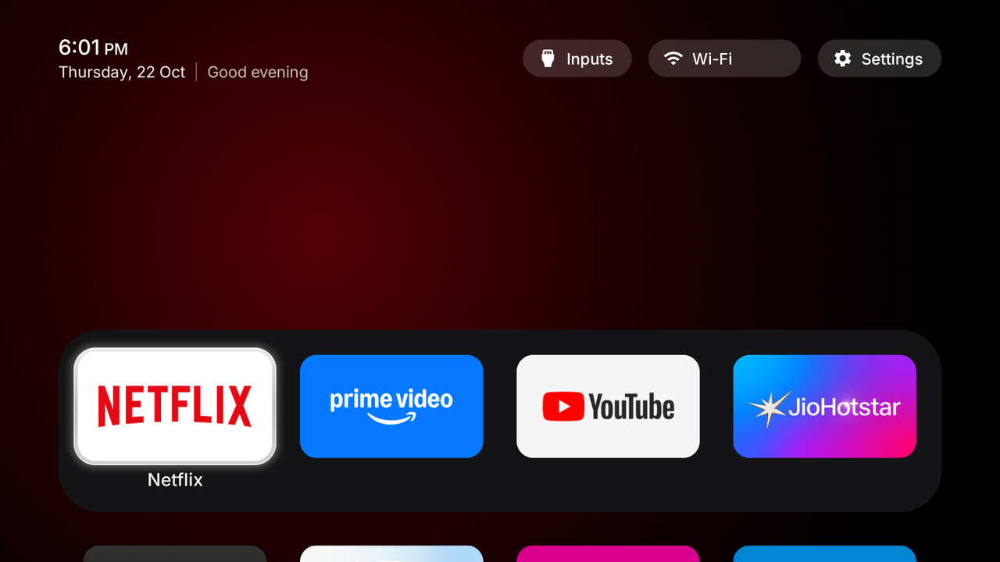
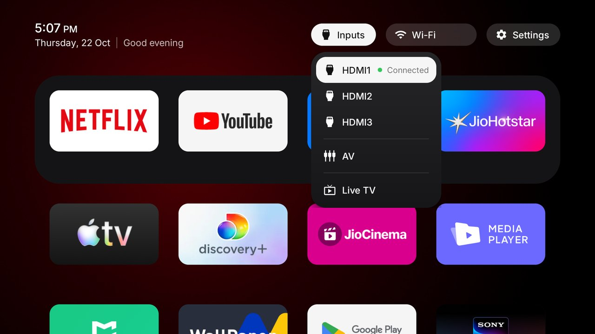
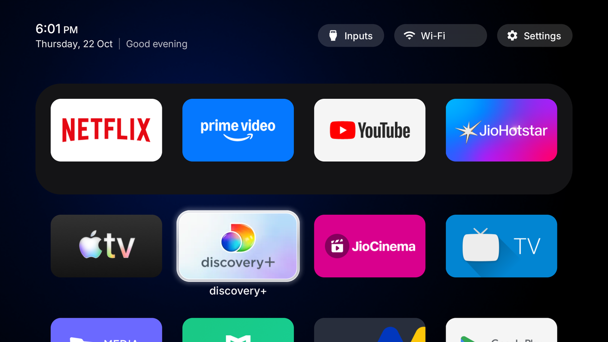
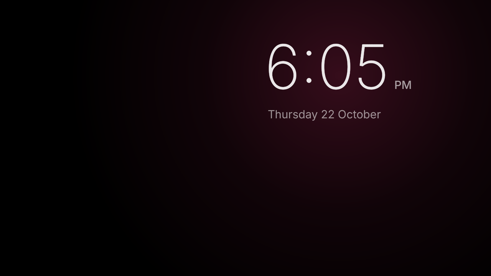

<p align="center">
  <a href="https://cleanyour.tv"></a>
</p>

<p align="center">
  <a href="https://cleanyour.tv">cleanyour.tv</a> ·
  <a href="PROMPT.md">The prompt</a> ·
  <a href="examples/">54 TV lists</a> ·
  <a href="SHOWCASE.md">12 built on it</a> ·
  <a href="https://x.com/gathint/status/2111379569030939102">The tweet</a>
</p>

<p align="center">
  <a href="https://github.com/Gathin23/cleanyourtv/stargazers"></a>
  <a href="https://github.com/Gathin23/cleanyourtv/pulls?q=is%3Amerged"></a>
  <a href="https://github.com/Gathin23/cleanyourtv/network/members"></a>
  <a href="https://github.com/Gathin23/cleanyourtv/graphs/contributors"></a>
  <a href="LICENSE"></a>
  <a href="https://buymeacoffee.com/gathint"></a>
</p>

Strip the bloatware from any Android TV or Google TV over Wi-Fi, and replace the ad-filled home
screen with a clean launcher that looks like an Apple TV. **No root, no cable, nothing uninstalled,
and a one-line restore if you change your mind.**

<h3 align="center">54 TVs with tested lists &nbsp;·&nbsp; 23 brands &nbsp;·&nbsp; 12 languages &nbsp;·&nbsp; 280 KB launcher</h3>


> Vibe coded my parents' TV this afternoon! It was showing a sponsored ad before you could even get
> to Netflix. Gave Claude Code the model number, it found the TV on wifi, removed 25 Xiaomi packages
> and wrote a new launcher. Looks like an Apple TV now lol.
>
> [@gathint, 17 October 2026](https://x.com/gathint/status/2111379569030939102). The replies are where
> most of the TV lists here came from. The repo was called tv-vibehack until the 19th; old links work.

## How it works

Android TVs have the same debug bridge as Android phones. Switch on USB debugging in the TV's
developer options, allow your computer once, and the rest is standard Android tooling:

1. **Back up** the list of installed packages and settings.
2. **Disable** the manufacturer's telemetry, ad services, content rows and preloaded junk with
   `pm disable-user`. Nothing is uninstalled, so a restore script can undo every step.
3. **Install** a small native launcher and make it the default home screen.

The bloat differs by brand, so the prompt has your coding assistant discover it on your TV and ask
before touching anything you might use.

## Quick start

You need a computer on the same Wi-Fi as the TV and a coding assistant with shell access
(Claude Code or similar).

| | |
|---|---|
| **1. On the TV** | Settings → Device Preferences → About → press OK on **Build** seven times → back → Developer options → **USB debugging** on. If you see a Network or ADB debugging toggle, turn that on too. Keep the TV on. |
| **2. On your computer** | Paste [`PROMPT.md`](PROMPT.md) into your assistant and fill in your TV model. |
| **3. Follow along** | Accept "Allow USB debugging?" on the TV, then answer the checklist: which apps you use, which four go in the dock, whether to keep the voice assistant, Chromecast and updates. |

The assistant backs up, debloats, builds and installs the launcher, and checks each step with
screenshots pulled from the TV. With this repo as context it takes about fifteen minutes.

## What you get

- **A softly coloured backdrop** and a translucent dock of your favourite apps at the bottom, with a broad, frosted glass band and a lit upper edge inspired by Apple TV.
- **A top shelf** naming the focused app in large type, with an ambient glow in a colour taken from its artwork.
- **A full-screen, six-column app grid** that slides up when you press Down from the dock.
- **Folders with 2×2 app previews** and a glass panel with four smaller tiles per row, centred contents and a height that fits its rows. Opening and closing are animated. Hold OK on a Home app for **Add to Folder → New Folder**, or choose an existing folder. Inside a folder, hold OK on an app and choose **Remove from folder** to return it to Home; the folder stays open so you can continue organizing. Removing the final app closes the empty folder. Names can be left blank: the title area stays empty until you press Up into it, revealing **Untitled folder** as the naming control. The name editor stays above the keyboard without shifting Home.
- **A soft focus halo in each app's colour**, with a lifted tile and a name below it. The halo leaves the app artwork untouched, without a white frame or frosted overlay.
- **Three frosted buttons**: Inputs (HDMI ports, AV, Live TV), Wi-Fi or Ethernet with the network name, Settings.
- **A greeting, a thin clock and the date** in [Outfit](https://fonts.google.com/specimen/Outfit), and a matching Clock screensaver.
- **Themes** that change colours, wallpaper, dock and columns without a rebuild, and **module cards** that let other apps plug a tile in, only with your say-so.

And a TV that stops working against you: no sponsored rows, no "Discover" nags, no analytics
phoning home, no apps you never asked for.

| | |
|---|---|
|  |  |
| *Top shelf and ambient glow* | *Inputs: HDMI with connection state, AV, Live TV* |
|  |  |
| *The grid, one glass highlight, the tile's name* | *Clock screensaver, drifts so nothing burns in* |
|  |  |
| *Aurora theme, pushed with `tools/theme.sh`* | *Six columns and a six-app dock, same launcher* |

## Supported TVs

Anything running **Android TV** or **Google TV**. Samsung (Tizen) and LG (webOS) run different
systems; see [SHOWCASE.md](SHOWCASE.md) for a webOS port. **Fire TV** takes the debloat half only,
since Fire OS will not hand Home to a third-party launcher. A few China-market TCL sets refuse to
install any launcher at all; their lists say so in the header.

Tested lists from contributors, one folder per model in [`examples/`](examples/):

**Xiaomi** 12 · **TCL** 11 · **Sony** 8 · **CHiQ** 2 · **Hisense** 2 · **Philips** 2 · Amazon Fire TV Stick · BenQ ·
Chromecast with Google TV · Hitachi · Insignia Fire TV · NVIDIA Shield · OnePlus · Panasonic · RCA · Redmi ·
SANYO · Skyworth · Thomson · Toshiba Fire TV · Vu · Stellamore and XGIMI projectors

<details>
<summary><strong>The full list</strong></summary>

| TV | OS |
|---|---|
| Amazon Fire TV Stick 4K, 1st gen 2018 (AFTMM, mantis) | Fire OS 6.7.1.1 / Android 7.1 |
| BenQ E55-735 (Changhong AI PONT, DVB96BQ) | Google TV 14 |
| CHiQ AI PONT (Changhong GTVU65, dangni, MediaTek mt5867) | Google TV 14 |
| CHiQ AI PONT (DVB93CQ) | Android TV 11 |
| Chromecast with Google TV 4K (sabrina) | Google TV 14 |
| Hisense HiSmartTV A4 (xiaoyushan, MStar m7322), India | Android TV 9 |
| Hisense SmartTV 4K FFM (huangshan, MediaTek) | Android TV 10 |
| Hitachi 65QLEDSM20 (MTC, bangbae, MediaTek m7322), Australia | Android TV 11 |
| Insignia 55" F30 4K Fire TV (NS-55F301NA25, AFTDCT31, duckie) | Fire OS 7 / Android 9 |
| NVIDIA SHIELD TV Pro 2019 (P2897, mdarcy) | Android TV 11 |
| OnePlus TV (D00, Dubai) | Google TV 14 |
| Panasonic 4KTV-JUP (Jupiter_PA, MediaTek) | Android TV 11 |
| Philips 50PUS8517/12 (TP Vision, PH1M_EA_9970A, MediaTek MT5895), Europe | Android TV 11 |
| Philips Smart 4K TV (Skyworth, eleonas, MediaTek), India | Google TV 14 |
| RCA AI PONT SA (Changhong, redwood, ISDB92RC; also sold as realme 40-inch) | Android 14 |
| Redmi TV (MiTV-ANTL0, starwars) | Android 5.1.1 (not Android TV) |
| SANYO ATV R2 (SCBC, Realtek RTD285O) | Android TV 9 |
| Skyworth SWTV-21AE (sunnyvale, MediaTek) | Android TV 14 |
| Sony BRAVIA 4K AE2 (BRAVIA_AE2, MediaTek MT5897), North America | Google TV 14 |
| Sony BRAVIA 4K GB (BRAVIA_ATV2_EU, BRAVIA_ATV2) | Android TV 9 |
| Sony BRAVIA 4K UR2 (BRAVIA_UR2_4K, MediaTek) | Android TV 10 |
| Sony BRAVIA 4K VH2 (KD-55X80J, BRAVIA_VH2, MediaTek), EU | Google TV 12 |
| Sony BRAVIA 9 II (K-65XR90M2, BRAVIA_AE3, MediaTek MT5838) | Google TV 14 |
| Sony BRAVIA BF1 (BRAVIA 2 II class, BRAVIA_BF1_4K_A, MediaTek) | Google TV 12 |
| Sony BRAVIA KD-65X80J (2021, BRAVIA_VH2, MediaTek), India | Google TV 10 |
| Sony BRAVIA XBR-65X900E (2017, BRAVIA_ATV2) | Android TV 9 |
| Stellamore T950S projector (Droidlogic be30a3, Amlogic txhd2) | Android 13 |
| TCL 40S5400A (C06, C06_2K_GB, MediaTek MT9221, 1 GB) | Android TV 11 |
| TCL 50EP680 (Europe, BeyondTV, Realtek rtd285o) | Android TV 11 |
| TCL 55" 4K Google TV, 2023 (G10, G10_4K_US_NF) | Google TV 12 |
| TCL 55Q10G Pro (China, tcl_mt5879_cn, MediaTek MT9952) | Android TV 11 |
| TCL 65C725 (Smart TV Pro, BeyondTV4) | Android TV 11 |
| TCL ak30a5 (China, Amlogic) | Android TV 9 |
| TCL BeyondTV (India) | Android TV 9 |
| TCL BeyondTV, EU/Nordic (Realtek RTD2851, V8-R851T02-LF1V606) | Android TV 9 |
| TCL BeyondTV2 (Latin America / Brazil, Realtek RTD2851) | Android TV 9 |
| TCL QM6K Pro, 2025 (G08, MediaTek tcl9618) | Google TV 14 |
| TCL Smart TV Pro (G05, G05_4K_US, MediaTek MT5889) | Google TV 11 |
| Thomson 32HE5800 (TCL-built UnionTV, Realtek RT2841), Spain | Android TV 9 |
| Toshiba Fire TV (AFTHA004, hazel) | Fire OS 7 / Android 9 |
| Vu 4K (HVCL, lushan, MediaTek), India | Google TV 12 |
| XGIMI Horizon S Pro projector (XK03H, xgimigalileo, MediaTek) | Android TV 11 |
| Xiaomi Mi Box S (MIBOX4, oneday), streaming box | Android TV 9 |
| Xiaomi Mi Box S 2nd gen (MiTV-AFKR0, jaws), streaming box | Google TV 11 |
| Xiaomi Mi TV (MiTV-MOOQ0, croods) | Android TV 10 |
| Xiaomi Mi TV 4A (MiTV-MOOQ1) | Android TV 10 |
| Xiaomi MiTV-AESP0 stick (aquaman, 1 GB) | Android TV 9 |
| Xiaomi MiTV-ASTP1 (maverick), China firmware 2.40.641.0514.cn, 1 GB RAM, 720p | Android TV 9 (CN build) |
| Xiaomi MiTV-AXSO0 (dangal; Mi TV 4C Pro 2019 / 4A Pro) | Android TV 9 |
| Xiaomi MiTV-MOOR2 (venom, MediaTek) | Google TV 11 |
| Xiaomi MiTV-MOSR4 (irobot, MediaTek) | Google TV 11 |
| Xiaomi MiTV-MSSP3 (machuca, MediaTek) | Android TV 11 |
| Xiaomi TV A Pro 75" 2026 (MiTV-MZTU0, river, MediaTek) | Google TV 14 |
| Xiaomi TV Box S 3rd gen (MiTV-AFMU0, twilight, Amlogic), streaming box | Google TV 14 |

</details>

Your TV not here? The prompt discovers the bloat itself. Add your list afterwards and the next
person with your model skips that step: [CONTRIBUTING.md](CONTRIBUTING.md).

## Doing it by hand

Everything the assistant does, you can run yourself. The tools need Python 3 and nothing else.

```bash
python3 -m venv tools/venv && tools/venv/bin/pip install -r tools/requirements.txt
export TV_HOST=192.168.1.50                                   # your TV's IP address

tools/venv/bin/python -I tools/tv.py --probe                 # model, Android version, firmware
tools/venv/bin/python -I tools/tv.py 'pm list packages'      # one shell command on the TV
tools/disable.sh examples/xiaomi-mi-tv-4a/debloat.txt        # apply a debloat list
tools/restore.sh examples/xiaomi-mi-tv-4a/debloat.txt        # undo it, stock launcher back
TV_HOST=192.168.1.50 launcher/build-and-install.sh           # build the launcher and make it Home
tools/theme.sh themes/aurora                                 # push a theme; --reset removes it
```

| Tool | What it does |
|---|---|
| [`tools/tv.py`](tools/tv.py) | Pure-Python ADB client: shell, batch, push, pull. Works where the stock `adb` binary is blocked. |
| [`tools/b64push.py`](tools/b64push.py) | Uploads large files such as APKs in base64 chunks and verifies the checksum. |
| [`tools/disable.sh`](tools/disable.sh), [`restore.sh`](tools/restore.sh) | Apply or undo a debloat list. |
| [`tools/theme.sh`](tools/theme.sh) | Push a folder from [`themes/`](themes/) to the launcher and restart Home. |
| [`launcher/build-and-install.sh`](launcher/build-and-install.sh) | Builds a shrunk release (about 280 KB), installs it, switches Home, and rolls back if Home does not land on it. |

Debloat list paths passed to `disable.sh` and `restore.sh` are relative to the directory you run
from, so your own lists can live outside the repository. Absolute paths also work.

Every script has a PowerShell twin next to it. On Windows with Android Studio installed nothing
else is needed:

```powershell
python -m venv tools\venv; tools\venv\Scripts\python.exe -m pip install -r tools\requirements.txt
powershell -ExecutionPolicy Bypass -File launcher\build-and-install.ps1 -TvHost 192.168.1.50
powershell -ExecutionPolicy Bypass -File tools\disable.ps1 -TvHost 192.168.1.50 examples\xiaomi-mi-tv-4a\debloat.txt
```

The install scripts ask the TV which launcher owns Home and only disable one they recognise
(`tvlauncher` or `launcherx`); pass `STOCK_LAUNCHER=<package>` (`-StockLauncher`) to override, or
`none` to leave it alone.

## The launcher

A small native Android TV app (`com.gathin.tvhome`, about 280 KB installed) in plain Java with
AndroidX RecyclerView and nothing heavier. Built for sets with 1 GB of RAM: static colour fields and
translucent glass surfaces, with no live blur, video, network requests, or background services.
Folders use a solid black backdrop that fades over the intact Home view, preserving the dock and
tile corners throughout the transition. No screenshot or blur preparation delays opening, and Home
stays laid out for an immediate return on Back. App menus and folder dialogs blur a small
snapshot of their own bounds once when opened. The material approximates the
screenshots on older Android TVs; it does not use Apple's native Liquid Glass renderer.
It needs JDK 17 and Android SDK platform 34 to build; on macOS,
`brew install openjdk@17 android-commandlinetools` and `sdkmanager "platforms;android-34" "build-tools;34.0.0"`. On Linux
the install script finds `~/Android/Sdk` and the `java` on your PATH.

- **Reorder apps** from the remote: hold OK on a tile to open its menu, then choose **Move**. The menu appears beside that tile, switching sides near the screen edge. Use the D-pad to move it, OK to save, or Back to cancel the whole move. Apps shift to make room, including across the first-row dock. **App settings** remains in the same menu. Saved order, folder names and membership survive restarts and app updates; newly discovered apps follow the saved apps. Leaving Home cancels an unconfirmed move. The same controls reorder apps inside a folder. Existing saved orders migrate automatically, and the original `app-order-v1.json` remains intact. Once customized, your order takes precedence over the theme's dock order; theme colours, wallpaper, hidden apps, and column count still apply.
- **Configure** in [`config.xml`](launcher/app/src/main/res/values/config.xml): dock order, hidden apps, the Live TV package, columns (tiles shrink from 5 up; 6 by default), rows under the dock, an optional VPN app for the network pill, and `reduced_motion` for TVs whose GPU cannot keep up.
- **Themes** set the same keys plus a background colour and a wallpaper from a `config.json` pushed to the TV, no rebuild. Three ship in [`themes/`](themes/), documented there.
- **Language** follows the TV: English, German, Spanish, Catalan, French, Russian, Serbian (Latin), Polish, Arabic, Simplified Chinese, Thai, Turkish. Android 13+ can set it for the launcher alone: `tools/tv.py 'cmd locale set-app-locales com.gathin.tvhome --locales ca'`.
  Russian includes the module-card approval and management screens and the VPN-off badge.
- **Module cards** let any TV app declare its own tile (label, caption, glow). The launcher asks you once per app, Keep hidden by default, and remembers the answer for that app's signing key and card name. Hold OK on Settings to change your mind. How to make one: [`docs/modules.md`](docs/modules.md); the contract: [`docs/specs/card.md`](docs/specs/card.md).
- **Clock screensaver**: a drifting clock over the glow, so nothing burns in. Pick "Clock" in the TV's screensaver settings, or over ADB:
  `tools/tv.py 'settings put secure screensaver_components com.gathin.tvhome/.ClockDream; settings put secure screensaver_enabled 1'`
- **Remote keys**: an optional accessibility service keeps the remote's Input button working on Google TV (`INPUT_KEY_SERVICE=1` at install), another fixes sticks whose Home key sends ALL_APPS and opens Settings from the remote's gear button, even one Android does not map (`HOME_KEY_SERVICE=1`, scancodes in `config.xml`).
- **Navigation** is deliberate: Up and Down move one row, the top buttons never fall through to tiles and Down from them returns to the dock tile you came from, Back closes a folder or the expanded grid, Home returns to the first dock tile, the last focused app is remembered, and installing or removing an app refreshes the tiles while Home is open.
- **Artwork**: app banners load at xhdpi or better, so low-density TV UIs do not downsample them before the focus zoom.

**Quick settings:** the gear icon opens a right-side group of frosted glass controls. The three
paired rows contain Bluetooth / Audio Output, Picture / Sound, and Screensaver / Apps. Each tile
has a filled white icon circle with a blue glyph. Focus adds a blue rim and a soft edge glow,
while keeping the glass material visible. Bluetooth opens the TV's accessories page; Picture and Sound
open their respective TV settings. Audio output opens the TV's output page where available, with
sound settings as a fallback. Apps opens the system Apps section. Screen saver starts the configured
screen saver where the TV exposes that action. The header has a Back-to-close hint and an **Open All Settings** gear.
The gear starts focused when the panel opens, so a second OK opens the full TV settings. Its small
label appears below the icon only while focused, without shifting the tiles when it disappears.
The Close icon shows its own caption in the same way. Opening and closing coordinate the glass
controls, backdrop dimming, and Home shortcuts in one transition; reduced motion uses a short fade.

Inputs and Wi-Fi remain on Home, and module cards remain available by holding OK on the gear.
Back closes the controls and restores the gear's focus; returning from a TV settings page
reopens the controls at the button that launched it, keeping Home's selected app and layout.

**Development checks:** run `./gradlew :app:testDebugUnitTest :app:assembleRelease :app:lintRelease`
from `launcher/`. The `LauncherSmoke` instrumentation runner checks native D-pad navigation,
long-press actions, move cancellation, folder persistence and layout, including a 36-app library.
Build `:app:assembleDebug :app:assembleDebugAndroidTest`, install both APKs on an Android TV emulator,
then run `adb -s emulator-5554 shell am instrument -w com.gathin.tvhome.test/com.gathin.tvhome.LauncherSmoke`.
It uses synthetic artwork and refuses to run on physical TVs. Screenshots are saved under the app's
external files directory in `ui-smoke/`. Other runners, selected with `-PlauncherTestRunner=<class>`:
`NavigationSmoke` (every column across off-screen and partial rows, queued/held keys, interrupted
transitions, folder navigation, Home/resume), `TopBarSmoke` (Down from each top button in every dock
column), `TransitionSmoke` (expansion/collapse frames without relayout or reverse jumps) and `MenuSmoke`
(menu blur, edge placement, remote focus, move cancellation). All of them use synthetic inventory and
must only run on an emulator.

`QuickSettingsSmoke` uses the existing app inventory without modifying it and can also run on a
physical TV. It checks the icon entry, control geometry and accessibility, D-pad routes, Back, and
return focus using monitored external launches. Install the matching **debug app and test APK**
(the optimized release APK removes resource classes used by instrumentation). Build its test APK with
`-PlauncherTestRunner=com.gathin.tvhome.QuickSettingsSmoke`.

`FolderMotionSmoke` measures click-to-motion and Back-to-motion timing, verifies that Home's holders
are retained, and compares native screenshot pixels around tile and dock corners at five points in
each transition. It also checks the solid black folder backdrop. It uses an existing folder on a
physical TV without changing its saved layout, and synthetic apps on an emulator.

Firmware-specific settings components, actions and slice resource names are declared in `config.xml`
and can be overridden through a theme; see [firmware settings routes](themes/README.md#firmware-settings-routes).
Other system Settings packages are discovered through Android's Settings action, with additional
public Apps and wireless settings fallbacks for firmware that omits a dedicated page.
`SettingsRoutingSmoke` checks those overrides, package discovery, destination availability and fallback order without
launching external settings pages. Run it on an emulator: it temporarily writes a test theme overlay
and restores the previous file before finishing. Select it with
`-PlauncherTestRunner=com.gathin.tvhome.SettingsRoutingSmoke`.

## Restoring your TV

Keep the list you applied. The restore script re-enables exactly those packages, puts the stock
launcher back as Home and resets the animation scales:

```bash
TV_HOST=192.168.1.50 tools/restore.sh examples/<your tv>/debloat.txt                                    # Android TV
TV_HOST=192.168.1.50 tools/restore.sh examples/<your tv>/debloat.txt com.google.android.apps.tv.launcherx  # Google TV
```

It leaves the new launcher installed (remove it from the TV's Settings → Apps if you want it gone)
and does not know about packages you disabled outside the list. To switch back later, run the
install script again; it works out which launcher to disable even when Home has fallen back to
Android's chooser. If the TV is unreachable, its own
Settings → Apps page can re-enable packages too.

## When something goes wrong

The full list of things that bit us is in [docs/TROUBLESHOOTING.md](docs/TROUBLESHOOTING.md). The
three that matter most:

- **macOS blocks `adb connect`** ("No route to host") under Local Network privacy. `tools/tv.py` avoids the binary.
- **Disable the stock launcher only after the new one is installed and running**, or Home lands on a factory test app. The install script orders this for you.
- **On Google TV the setup wizard** (`com.google.android.tungsten.setupwraith`) can take Home and crash-loop the system after the stock launcher is disabled. Disable it too, and list it in your `debloat.txt` so restore brings it back. Stuck already? `tools/tv.py 'pm enable --user 0 com.google.android.apps.tv.launcherx'`.

## Questions people ask

**Is this safe? Can it brick the TV?** Nothing is flashed, rooted or deleted; packages are disabled
in the user profile. The risk is disabling something the TV leans on, which is why lists are
applied in small batches with a restore script ready. The TV's own Settings → Apps page can
re-enable packages even without the tools.

**What about firmware updates?** Most lists disable the update service, so updates arrive only when
you re-enable it. If one lands, the worst case is a package coming back and you re-run the script.

**Won't the apps break?** Streaming apps still update through the Play Store, which is left alone.
The launcher just lists what is installed and launches it with intents that have been stable for a decade.

**Isn't ADB access a security hole?** It is one explicit "allow this computer" tap on the TV, the
same as developing an Android app. Switch USB debugging off afterwards; the launcher keeps working.

**Can it block ads inside apps too?** Partly, with Android's Private DNS (Android 9 and newer). Point
it at an ad-blocking resolver such as [AdGuard DNS](https://adguard-dns.io) and every app's ad and
tracker domains stop resolving, system-wide, surviving reboots. The trade-off: that resolver then
sees every DNS query the TV makes.

```bash
tools/tv.py 'settings put global private_dns_specifier dns.adguard-dns.com'
tools/tv.py 'settings put global private_dns_mode hostname'
```

It does not remove YouTube ads, which come from the same servers as the videos. If an app stops
playing or the TV reports "No internet" (the resolver is down or unreachable), switch back with
`tools/tv.py 'settings put global private_dns_mode opportunistic'`.

**AirPlay?** Not from this repo. Chromecast built-in stays for Android phones. For iPhones,
[jqssun/android-airplay-server](https://github.com/jqssun/android-airplay-server) works; an install
script for it is in [PR #84](https://github.com/Gathin23/cleanyourtv/pull/84).

**Can I just download the APK?** Build it with the one-line script; it takes a minute and you
control what goes on your TV. No prebuilt binaries.

## Contributing

The most useful contribution is your TV's debloat list, so the next person with that model does
not have to rediscover it. Launcher improvements and sharper prompt wording are welcome too.
[CONTRIBUTING.md](CONTRIBUTING.md) has the format and the testing we ask for. Built something on
top, a launcher, a port, a theme? Add it to [SHOWCASE.md](SHOWCASE.md), where eleven projects already
live: a webOS port for LG, a Stremio shelf, a Hisense restyle, Fire TV launchers, an AirPlay installer.

The people whose work is in this repo:

<a href="https://github.com/Gathin23/cleanyourtv/graphs/contributors"></a>

<details>
<summary><strong>Star history</strong></summary>

<a href="https://star-history.com/#Gathin23/cleanyourtv&Date"></a>

</details>

## Licence

MIT, see [`LICENSE`](LICENSE). The Outfit typeface is under the SIL Open Font License, see
`launcher/FONT-LICENSE-OFL.txt`.
