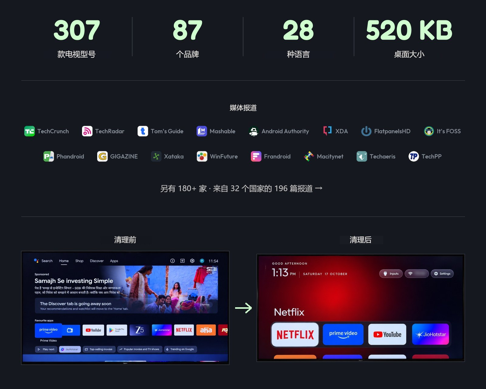
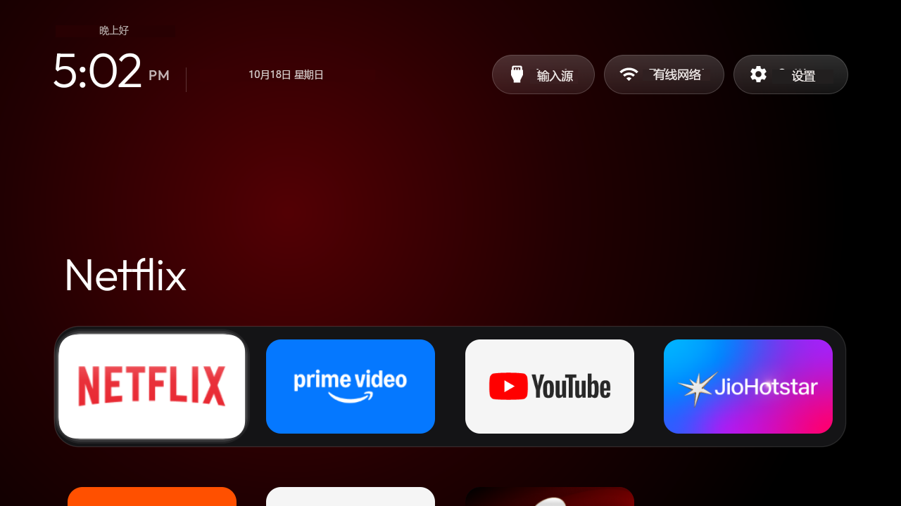
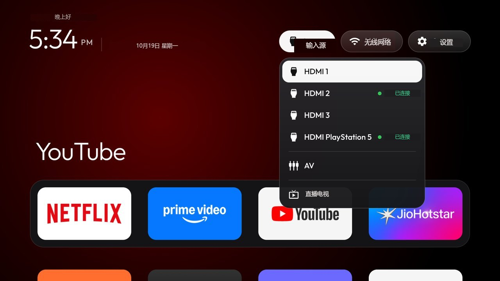
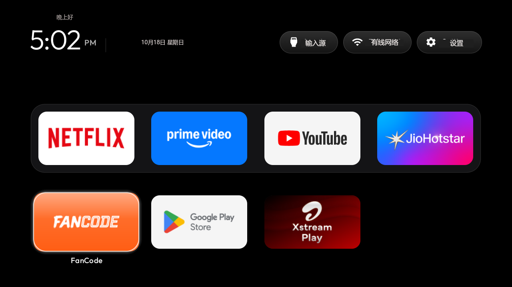
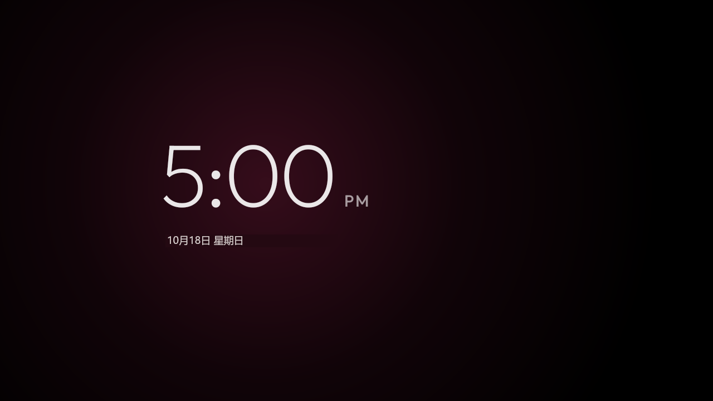
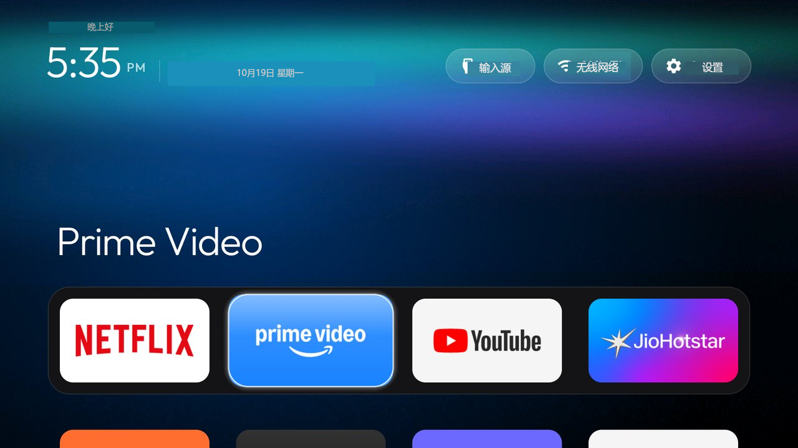
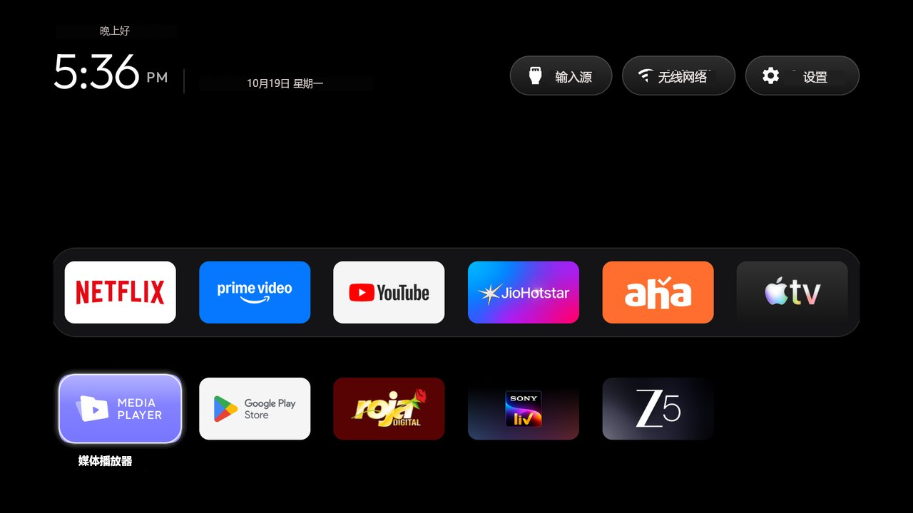
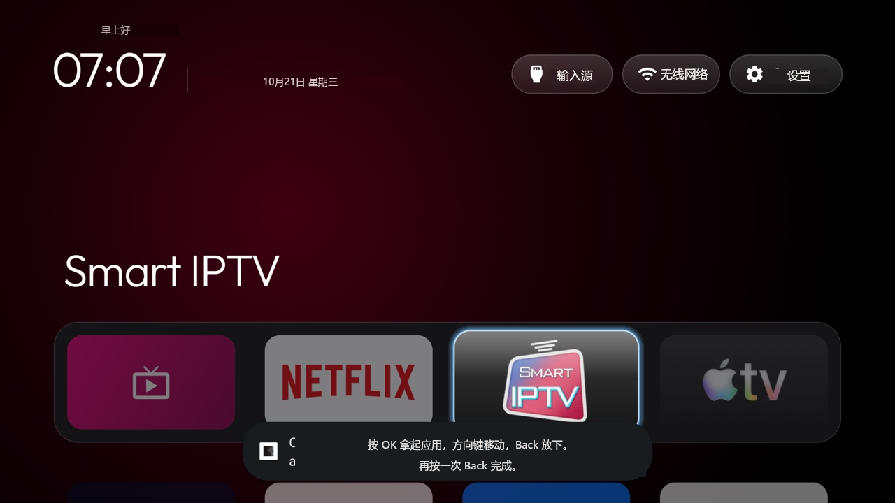
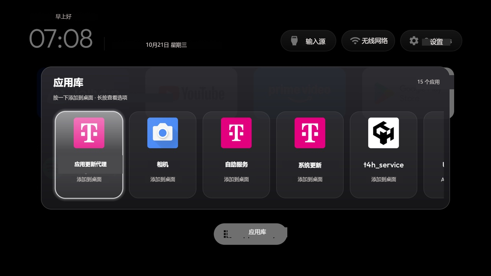

<p align="center">
  <a href="https://cleanyour.tv"></a>
</p>

<p align="center">
  <a href="https://github.com/Gathin23/cleanyourtv/stargazers"></a>
  <a href="https://github.com/Gathin23/cleanyourtv/pulls?q=is%3Amerged"></a>
  <a href="https://github.com/Gathin23/cleanyourtv/network/members"></a>
  <a href="https://github.com/Gathin23/cleanyourtv/graphs/contributors"></a>
  <a href="README.md"></a>
  <a href="https://buymeacoffee.com/gathint"></a>
  <a href="https://www.producthunt.com/products/cleanyourtv"></a>
</p>

<p align="center">
  <a href="README.md">English</a> · 简体中文 · <a href="README.vi.md">Tiếng Việt</a> · <a href="README.ja.md">日本語</a> · <a href="README.it.md">Italiano</a>
</p>

<p align="center">
  <a href="https://trendshift.io/repositories/310225"></a>
</p>

<p align="center">
  <a href="docs/PRESS.md"></a>
</p>

**那条刷屏的推文：** [x.com/gathint/status/2111379569030939102](https://x.com/gathint/status/2111379569030939102)

2026 年 10 月 17 日，我发了一组父母家电视的前后对比图——那是 Claude Code 通过 Wi-Fi 帮我清理干净的。
这条推文获得了 740 万次浏览，很多人开始对自己的电视下手，他们的回复最终变成了这里的清单：四天之内，200 多位贡献者提交了 170 多种电视型号。仓库在 19 日之前叫 `tv-vibehack`，旧链接依然有效。

**主题、开关与扩展插件：** [cleanyour.tv/addons](https://cleanyour.tv/addons)

**官方链接：** 官网是 [cleanyour.tv](https://cleanyour.tv)，代码、桌面和工具只存放在本仓库。其他使用同名域名的站点（例如 cleanyourtv.com）并非本项目运营（见 [#1004](https://github.com/Gathin23/cleanyourtv/issues/1004)）。

> 说明：本文为英文 README 的完整中文版。文中涉及的机型型号、系统版本号、包名、命令、路径、品牌名称保留原文形式；随仓库发布的 `docs/` 下文档目前仍为英文。

## 工作原理

Android 电视和 Android 手机一样带有调试桥。在电视的开发者选项里打开 USB 调试，允许电脑连接一次，剩下的都是标准的 Android 工具流程：

| 步骤 | 做了什么 |
|---|---|
| **备份** | 记录已安装应用包列表和相关设置。 |
| **停用** | 用 `pm disable-user` 停用厂商的遥测、广告服务、推荐内容行和预装垃圾应用。**不卸载任何东西**，所以恢复脚本可以撤销每一步。 |
| **安装** | 安装一个体积很小的原生桌面，并设为默认主屏。 |

**无需 root、无需数据线、不卸载任何东西；如果后悔了，一行命令即可还原。**

各品牌的预装软件并不相同，所以提示词会让你的编程助手先在电视上实地探查，并在改动你可能用到的任何东西之前征求你的同意。

## 快速开始

| 你手上有什么 | 该怎么做 |
|---|---|
| **一台电脑** | 配合编程助手使用提示词，即下面三步。 |
| **只有一台 Android 手机** | 使用社区开发的 [Clean Your TV 应用](https://cleanyour.tv/app)（作者 [@udhaykumarbala](https://github.com/udhaykumarbala)）：连接、分析、清理，大约五分钟搞定。不需要笔记本，也不需要编程助手。 |

用电脑的话，电脑需要和电视连在同一个 Wi-Fi 下，并且有一个能执行 shell 命令的编程助手。

以下任意一种都可以：Claude Code（在 [0G Private Computer](https://pc.0g.ai) 上，或使用 [Anthropic 订阅](https://claude.com/pricing)）、[Codex](https://github.com/openai/codex) 或 [Gemini CLI](https://github.com/google-gemini/gemini-cli)。

| 在哪里 | 做什么 |
|---|---|
| **1. 在电视上** | 设置 → 设备偏好设置 → 关于 → 在**版本号（Build）**上连按七次 OK → 返回 → 开发者选项 → 打开 **USB 调试**。如果还能看到「网络调试」或「ADB 调试」开关，也一并打开。电视保持开机。 |
| **2. 在电脑上** | 克隆仓库，并在助手里打开该文件夹（`git clone https://github.com/Gathin23/cleanyourtv`），然后粘贴 [`PROMPT.md`](PROMPT.md) 并填入你的电视型号。 |
| **3. 跟着走** | 在电视上接受「允许 USB 调试？」提示，然后回答清单里的问题：你用哪些应用、底部程序坞放几个、应用顺序、是否保留语音助手、Chromecast 和系统更新。 |

**克隆这一步很重要：** 助手会复用本仓库的 `tools/disable.sh` 和 `launcher/build-and-install.sh`，而不是自己另写一套——备份、HOME 守卫和恢复记录都在这些脚本里。

助手会完成备份、清理、编译并安装桌面，并从电视上抓截图逐步核验。以本仓库作为上下文，整个过程大约十五分钟。

## 你会得到什么

一个看起来像 Apple TV、又不会打扰你的主屏：

| 组成部分 | 长什么样 |
|---|---|
| **纯黑主屏** | 一条圆角横带里放你最爱的四个应用，位置和 Apple TV 一致。 |
| **顶部信息条（Top shelf）** | 用大字显示当前聚焦的应用名称，并从它的封面图里取一种颜色作为环境光晕。 |
| **其余应用网格** | 按「下」键时向上滑出。 |
| **一个浮动的玻璃高亮框** | 从一个磁贴弹跳到另一个。聚焦的磁贴会上浮并显示名称。 |
| **三个磨砂按钮** | 输入源（你在电视设置里命名过的 HDMI 接口、AV、直播电视）、Wi-Fi 或以太网（显示网络名）、设置。 |
| **问候语、细体时钟和日期** | 使用 [Outfit](https://fonts.google.com/specimen/Outfit) 字体，并配一个风格一致的时钟屏保。在配置或主题里设置 `show_stats` 后，时钟下方会多一行：CPU、可用内存和可用存储。默认关闭，只有你打开才显示，而且只在主屏可见时刷新。 |
| **主题与模块卡片** | 主题可以在不重新编译的情况下更换配色、壁纸、程序坞和列数；模块卡片让其他应用在你的许可下插入自己的磁贴。 |

以及一台不再跟你作对的电视：没有赞助内容行、没有「发现」页的骚扰、没有偷偷回传的分析数据、没有你从没要过的应用。

| | |
|---|---|
|  |  |
| *顶部信息条与环境光晕* | *输入源：HDMI（含连接状态）、AV、直播电视* |
|  |  |
| *网格、一个玻璃高亮框、磁贴名称* | *时钟屏保，会缓慢漂移，避免烧屏* |
|  |  |
| *极光主题，用 `tools/theme.sh` 推送* | *六列加六应用程序坞，同一个桌面* |
|  |  |
| *启用 `tile_menu` 后，在磁贴上长按 OK 选「移动」：方向键搬运，Back 放下* | *应用库：按一下就能把移除的应用放回主屏* |

## 支持的电视

任何运行 **Android TV** 或 **Google TV** 的设备都可以。

| 平台 | 能做到什么 |
|---|---|
| **Android TV、Google TV** | 清理和桌面都可以。 |
| **Fire TV** | 只能做清理这一半，因为 Fire OS 不会把 Home 交给第三方桌面。而 2015 年的 Fire TV Box（Fire OS 5）连这一半都会失败：所有 `pm` 途径都被拒绝。 |
| **部分中国市场的 TCL 机型** | 它们完全拒绝安装任何第三方桌面；对应的清单在文件开头已注明。 |
| **三星（Tizen）、LG（webOS）** | 属于另一套系统。三个 webOS 移植版的说明见 [SHOWCASE.md](SHOWCASE.md#other-platforms-fire-tv-and-lg-webos)；如果你在考虑 Tizen 移植，[docs/devices/samsung-tizen.md](docs/devices/samsung-tizen.md) 记录了 2021 年一台三星电视通过 Wi-Fi 能回答什么（没有 ADB，因此没有 `pm disable-user`）。 |

以下是由贡献者提供的实测清单，[`examples/`](examples/) 下每个型号一个文件夹：

<!-- tv-brands:start: 由 tools/gen_tables.py 依据 examples/*/tv.json 生成；请改那些文件，不要改这里 -->

**TCL** 68 · **Sony（索尼）** 37 · **Xiaomi（小米）** 31 · **Philips（飞利浦）** 17 · **Skyworth（创维）** 11 · **Hisense（海信）** 10 · **Amazon Fire TV** 7 ·
**BenQ（明基）** 4 · **OnePlus（一加）** 4 · **Panasonic（松下）** 4 · **Thomson** 4 · **Google** 3 · **Haier（海尔）** 3 · **JVC** 3 ·
**NVIDIA Shield** 3 · **SHARP（夏普）** 3 · **Vu** 3 · **CHiQ（长虹）** 2 · **FFalcon（雷鸟）** 2 · **Hitachi（日立）** 2 · **Insignia Fire TV** 2 ·
**Kalley** 2 · **Kogan** 2 · **Motorola（摩托罗拉）** 2 · **Nokia（诺基亚）** 2 · **onn** 2 · **RCA** 2 · **Redmi（红米）** 2 · **RockTek** 2 ·
**Sankey** 2 · **Toshiba（东芝）** 2 · **Vidda** 2 ·
Acer · AiPro2K · AIWA · AQUA · Artel · ASUS（华硕）· Beko · Caxium · Cecotec · Challenger · Compac · Dcolor · Dialog · EKO ·
Freebox · Grundig · INCLO · Karbonn · KTC · Liberton · Lumio · Master-G · MTC · Next · Noblex · OK. · Panavox · PEAQ ·
Polytron · PRISM+ · SANYO（三洋）· Sber · Seleco · Super General · Tele System · TiVo · Tornado · Turkcell · Tuvio · Verizon ·
Vision ·
以及 Alwtniet、Anker Nebula、BYINTEK、Epson（爱普生）、Formovie（峰米）、Gadnic、HOTACK、HY320、JMGO、Magcubic、Portronics、Stellamore、Wanbo、XGIMI（极米）等品牌的投影仪

<!-- tv-brands:end -->

> **完整机型清单（共 307 款）不再在此复制。** 它由 `tools/gen_tables.py` 从 [`examples/`](examples/) 下各机型的 `tv.json` 自动生成，维护者只在 main 上重新生成英文版，所以译文里存一份副本很快就会与上游对不上。
>
> 需要逐款核对时，请直接看英文 README 的 [Supported TVs](README.md#supported-tvs) 表格，或浏览 [`examples/`](examples/) 目录——每个机型一个文件夹，里面的清理清单可以直接拿来用。
>
> 机型标识属于硬件识别码（例如 `MiTV-MSSP3 (machuca, MediaTek)`），与电视系统里显示的型号字符串一致，无需翻译。

你的电视不在清单里？提示词会自己去探查预装软件。之后把你的清单提交上来，下一个用同款机型的人就能省掉这一步：[CONTRIBUTING.md](CONTRIBUTING.md)。

## 手动操作

助手做的每一件事，你都可以自己跑。工具只依赖 Python 3，不需要别的东西。
`tools/tv.py` 通过 5555 端口连接网络 ADB。如果该端口不通，而电视提供了带配对码的无线调试（Chromecast with Google TV 和 Google TV Streamer 属于这种情况），先用原版 `adb` 配对一次，再执行 `adb tcpip 5555`，具体步骤见[常见问题排查](docs/TROUBLESHOOTING.md#connecting)。

```bash
python3 -m venv tools/venv && tools/venv/bin/pip install -r tools/requirements.txt
export TV_HOST=192.168.1.50                                   # 你电视的 IP 地址

tools/venv/bin/python -I tools/tv.py --probe                 # 型号、Android 版本、固件
tools/venv/bin/python -I tools/tv.py 'pm list packages'      # 在电视上执行一条 shell 命令
tools/disable.sh examples/xiaomi-mi-tv-4a/debloat.txt        # 应用一份清理清单
tools/restore.sh examples/xiaomi-mi-tv-4a/debloat.txt        # 撤销清理，恢复原厂桌面
tools/venv/bin/python -I tools/check.py examples/xiaomi-mi-tv-4a/debloat.txt   # 检查固件更新撤销了什么
TV_HOST=192.168.1.50 launcher/build-and-install.sh           # 编译桌面并设为 Home
tools/theme.sh themes/aurora                                 # 推送主题；加 --reset 移除
```

| 工具 | 作用 |
|---|---|
| [`tools/tv.py`](tools/tv.py) | 纯 Python 的 ADB 客户端：shell、批量、push、pull、重启和截图，还可以先按遥控器按键。在原版 `adb` 可执行文件被封禁的环境里也能用。 |
| [`tools/b64push.py`](tools/b64push.py) | 以 base64 分块上传 APK 之类的大文件，并校验校验和。 |
| [`tools/relay.py`](tools/relay.py) | 把本地端口转发到电视的 ADB 端口，适用于沙箱访问不到你所在网络的助手。只监听本机。[说明](tools/relay.md)。 |
| [`tools/disable.sh`](tools/disable.sh)、[`restore.sh`](tools/restore.sh) | 应用或撤销一份清理清单，撤销基于改动前记录的状态。 |
| [`tools/recovery.py`](tools/recovery.py) | 写入 `disable.sh` 自我撤销所需的记录，并打印恢复批处理命令。 |
| [`tools/check.py`](tools/check.py) | 把电视当前状态与已应用的清单比对，找出固件更新撤销了什么；`--fix` 会把它们改回去。 |
| [`tools/adb-closed.py`](tools/adb-closed.py) | 调试关闭后确认电视的网络 ADB 端口已关闭：无响应时退出码 0，仍开放时 1，检查本身无法执行时 2。不需要 `nc`。 |
| [`tools/privacy.py`](tools/privacy.py) | 审计电视上的语音、ACR 和遥测候选包，并给出每一项的证据；`--write` 会把结果写成 `disable.sh` 和 `restore.sh` 能直接读取的清单。 |
| [`tools/theme.sh`](tools/theme.sh) | 把 [`themes/`](themes/) 里的某个文件夹推送到桌面并重启主屏。 |
| [`tools/manage.py`](tools/manage.py) | 列出所有扩展、主题和开关及其截图，查看电视上已装了什么，并通过运行作者自己的脚本完成安装、更新或移除。 |
| [`tools/bench.py`](tools/bench.py) | 测量接管 HOME 的桌面的表现：按键延迟、焦点移动距离、卡顿帧数、冷启动、返回主屏耗时，以及待机时的 CPU 和 PSS 开销。不改变电视上的任何东西，并把每次按键的原始数据写入 JSON；不需要额外安装。 |
| [`tools/trace.py`](tools/trace.py)、[`trace_report.py`](tools/trace_report.py) | 录制桌面的 Perfetto trace（返回主屏、冷启动、方向键），并报告时间花在哪里，支持单次以及改动前后对比。可选，需要 [`requirements-perf.txt`](tools/requirements-perf.txt)。[说明](tools/trace.md)。 |
| [`tools/flamechart.py`](tools/flamechart.py) | 用上面的 trace 画出改动前后的火焰图，适合放进 PR：一条线程一个泳道、共享时间轴，被改动的部分用洋红色标出并给出总计。和 trace 工具一样是可选的。[说明](tools/flamechart.md)。 |
| [`tools/screendiff.py`](tools/screendiff.py) | 逐像素比较改动前后的截图，可以排除时钟或你指定的任何区域，并输出一张把你 Wi-Fi 名称打码的对比图。和 trace 工具一样是可选的。[说明](tools/screendiff.md)。 |
| [`tools/race_calendar.py`](tools/race_calendar.py) | 从免费的 Jolpica API 把本赛季 F1 赛历写进主题，用于比赛周末模式。 |
| [`launcher/build-and-install.sh`](launcher/build-and-install.sh) | 编译精简版发行包（约 520 KB）、安装、切换 Home，如果 Home 没有落到它身上就自动回滚。 |

**这些脚本绝不会让电视没有桌面可用**：它们只会停用自己认识的原厂桌面，并且在有别的桌面能响应 HOME 之前，跳过清单里的 Home 应用。细节见下文。

<details>
<summary><b>Windows（PowerShell）</b></summary>

每个脚本旁边都有对应的 PowerShell 版本。在已安装 Android Studio 的 Windows 上不需要别的东西：

```powershell
python -m venv tools\venv; tools\venv\Scripts\python.exe -m pip install -r tools\requirements.txt
powershell -ExecutionPolicy Bypass -File launcher\build-and-install.ps1 -TvHost 192.168.1.50
powershell -ExecutionPolicy Bypass -File tools\disable.ps1 -TvHost 192.168.1.50 examples\xiaomi-mi-tv-4a\debloat.txt
```

</details>

<details>
<summary><b>脚本如何保护 Home</b></summary>

安装脚本会先问电视当前由哪个桌面接管 Home，并且只停用自己认识的那一个，也就是 `KNOWN_STOCK_LAUNCHERS` 里的四个：`com.google.android.tvlauncher`、`com.google.android.apps.tv.launcherx`、`com.google.android.leanbacklauncher` 以及小米的 `com.mitv.tvhome`（PatchWall）。传入 `STOCK_LAUNCHER=<包名>`（`-StockLauncher`）可以覆盖判断，传 `none` 则完全不动它。

`tools/disable.sh`（`disable.ps1`）在停用任何东西之前也遵循同样的规则：如果清单里包含接管 Home 的应用，而电视上没有别的应用能响应 HOME，它就跳过这一条、说明原因，然后停用清单里的其余部分。设置向导、设置应用、厂商的 `FallbackHome` 和出厂测试应用（小米的 `com.duokan.factorytest`）也会响应 HOME，但不算数。所以在桌面交接之前应用清单，不会让电视开机后什么都没有。等 `launcher/build-and-install.sh` 把新桌面设为 Home 之后，再跑一次同样的清单，这一条就会被应用；`FORCE_HOME=1`（PowerShell 里是 `$env:FORCE_HOME`）可以强制停用。

</details>

<details>
<summary><b>清单可以放在哪里</b></summary>

传给 `disable.sh` 和 `restore.sh` 的清理清单路径相对于你执行的目录，所以自己的清单可以放在仓库之外。绝对路径同样可用。

</details>

## 麦克风，以及关于它能说些什么

「这些包里哪一个在监听？」没有诚实的一句话答案，而权限扫描只会让事情更糟：在很多机型上，大部分包都以 `android.uid.system` 身份运行，于是五十个包都显示 `RECORD_AUDIO: granted=true`，但没有一个真的在录音。在另一些机型上，麦克风在遥控器里而不是电视面板上，于是一个完全没有音频权限的包依然能看到屏幕上的所有内容——像 `tv.inscape.tvclient.inscapeacr` 这样的 ACR 客户端只需 `INTERNET` 权限，就能根据画面识别内容。

`tools/privacy.py` 报告的是电视实际怎么说，而不是猜测：
`TV_HOST=192.168.1.50 tools/venv/bin/python -I tools/privacy.py` 会把语音、ACR 和遥测候选分成三组打印，每一项都附带证据——来自固件自己的 `voice_interaction_service` 命名、来自 [`examples/`](examples/) 的已知组件，或者仅仅是名字匹配——同时给出该包是否声明了 `RECORD_AUDIO`、是否共用系统 UID、以及返回的 AppOps 历史里是否包含麦克风访问。仅仅配置了某种模式或有过一次被拒绝的尝试，都不构成访问的证据。

`--write privacy.txt` 会把识别出的候选写成一个标准的清理清单，于是应用和撤销用的还是你熟悉的那两条命令（`tools/disable.sh`、`tools/restore.sh`）。仅靠名字匹配的包默认不会写进去，除非你加 `--include-low`；这些包建议先用 `dumpsys package <名称>` 核实。

审计做不到的是证明意图。`appops` 只能说明某个操作被触碰过，不能说明之后数据流去了哪里；而任何基于包名的扫描都无法证明一台电视在或不在录音。停用语音助手是一笔有明确代价的交易（遥控器上的麦克风键、应用内的语音搜索），所以报告会逐包列出这个代价，而不是简单说「赢了」。

## 桌面

一个为 Android TV 打造的小体积原生主屏：**约 520 KB**，纯 Java 编写，专为 1 GB 内存的电视而做。没有模糊效果、没有视频、不申请网络权限、没有后台服务。

电视需要 **Android 8.0（API 26）或更高版本**：`minSdk` 是 [`launcher/app/build.gradle`](launcher/app/build.gradle) 里的编译期下限，而安装脚本会在编译前向电视查询 `ro.build.version.sdk`，所以较老的机型会被告知这两个数字，而不是在 `pm install` 阶段失败（这类机器上还能做什么，见[常见问题排查](docs/TROUBLESHOOTING.md)）。

| 项目 | 实现方式 |
|---|---|
| **配置** | 程序坞顺序、隐藏应用、直播电视应用、每行 4 到 7 个磁贴、减弱动效。全部在 [`config.xml`](launcher/app/src/main/res/values/config.xml) 里 |
| **电视上的设置** | 在「设置」上长按 OK 进入桌面设置。可选的 `launcher_settings_button` 让普通点击直接打开它们；电视自身的设置仍保留在设置页和它的应用磁贴里。 |
| **主题** | 通过 Wi-Fi 推送一个 `config.json` 就能换背景、壁纸和布局，无需重新编译。[`themes/`](themes/) 内置十套，包含默认的 `default/` |
| **28 种语言** | 跟随电视语言，希伯来语有完整镜像的从右到左布局 |
| **应用库** | 可选：浏览所有已安装应用，增删主屏快捷方式。见[应用库指南](docs/app-library.md) |
| **磁贴菜单** | 可选（`tile_menu`）：在磁贴上长按 OK 出现「移动」「从主屏移除」「应用信息」。关闭时长按 OK 直接打开应用信息 |
| **模块卡片** | 任何电视应用都能提供自己的磁贴；每一个都需要你批准一次。见 [`docs/modules.md`](docs/modules.md) |
| **扩展插件** | 作为模块卡片接入的可选应用，放在 [`addons/`](addons/)，永远不会编进桌面本身 |
| **时钟屏保** | 一个在光晕上漂移的时钟，避免烧屏 |
| **遥控器按键** | 原厂桌面被移除后，继续保住「输入源」「YouTube」和齿轮键 |

<details>
<summary><b>自己编译</b></summary>

需要 JDK 17 和 Android SDK platform 34。macOS 上：`brew install openjdk@17 android-commandlinetools`
然后 `sdkmanager "platforms;android-34" "build-tools;34.0.0"`。Linux 上安装脚本会自己找到
`~/Android/Sdk` 和 PATH 里的 `java`。

</details>

<details>
<summary><b>配置</b></summary>

[`config.xml`](launcher/app/src/main/res/values/config.xml) 设置程序坞顺序、隐藏的应用、直播电视包名、列数（超过 5 个磁贴会缩小）、程序坞下方保留的行数、可选的用于网络胶囊的 VPN 应用，以及给 GPU 跟不上的电视使用的 `reduced_motion`。主题可以设置同样的键，外加一个背景色和一张壁纸。

</details>

<details>
<summary><b>桌面设置与默认主屏</b></summary>

- 点击**设置**进入电视自身的设置。在它上面长按 OK 打开菜单：**桌面设置**（启用 `launcher_settings_button` 后普通点击直接进入这里，菜单里就不再出现这一项）、**原生设置**（当电视在 Android 设置之外还自带一套设置应用时出现——小米中国版、TCL/FFALCON 和 Fire OS 都在 `settings_fallback_components` 里——因为那套应用里有 Android 设置没有的页面，例如小米的「账号与安全」里的 ADB 开关）、**模块卡片**（配合 `module_cards`）、**编辑程序坞**（配合 `dock_row`）、以及**应用排序**。桌面自己的设置页从上到下是这些项：
  - **应用排序**，仅在启用 `launcher_settings_button` 时出现：按 OK 拿起一个应用，方向键移动，Back 放下，再按一次 Back 结束。
  - **每行应用数** 4、5、6 或 7；**程序坞下方行数** 0 到 3，即程序坞横带下方保持可见的磁贴行数；**程序坞横带不透明度** 100%、70%、50% 或 30%。后两项只有在程序坞独占一行（`dock_row`，默认开启）时才生效。
  - **壁纸**：从主题的图集里选一张（或它的 `wallpaper.jpg`）、**无**、或**主题默认**。选定后会固定该图片并停止轮换，直到你选择「主题默认」、按「跟随主题」或重新推送主题。
  - **动画**开关，以及动画打开后的**高级效果**（磁贴上浮、图标缩放和柔和的环境色过渡；可能占用更多内存）。
  - **启动时打开**，仅在启用 `open_on_start_choice` 时出现：关闭，或指定一个应用——电视开机后主屏第一次出现时改为打开它。每次开机只执行一次，所以 Home 和 Back 依然能回到桌面。
  - **跟随主题（重置电视端选择）**，会清除上面所有选择。推送或重置主题同样会清除它们。
  - **选择默认主屏**打开 Android 的主屏选择器，**电视系统设置**打开电视自己的设置页。
- **更换默认主屏：** 桌面设置和可选的「默认主屏」磁贴（`show_home_settings_shortcut`）都会打开 Android 的主屏选择器。选择原来的桌面就不再用 CleanYourTV 作为 Home，选 CleanYourTV 则回来。原桌面必须处于启用状态；如果安装脚本停用了它，请先运行下面的恢复脚本。有些电视不提供主屏选择器。

</details>

<details>
<summary><b>语言</b></summary>

英语、德语、丹麦语、西班牙语、加泰罗尼亚语、法语、俄语、塞尔维亚语（拉丁字母）、波兰语、捷克语、意大利语、葡萄牙语、土耳其语、阿拉伯语、希伯来语、简体中文、繁体中文（台湾）、泰语、芬兰语、越南语、孟加拉语、印尼语、挪威博克马尔语、荷兰语、乌兹别克语（拉丁字母）、乌克兰语和韩语。桌面跟随电视语言。Android 13 及以上可以只为桌面单独设置：
`tools/tv.py 'cmd locale set-app-locales com.gathin.tvhome --locales ca'`。

希伯来语会镜像整个布局：菜单按钮在左，日期和时钟在右且问候语在其上方，程序坞和应用行从右侧开始并配套遥控器导航，输入源选择器的图标和标签在右，日期带月份前缀 ב（例如 19 באוקטובר）。时钟屏保的日期和时间也右对齐。俄语覆盖了每一个界面，包括比赛周末、节日问候和波斯历日期。其他语言保持原有布局。

</details>

<details>
<summary><b>模块卡片</b></summary>

任何电视应用都可以声明自己的磁贴（标签、说明、光晕）。桌面会为每个应用询问你一次，默认保持隐藏，并按该应用的签名密钥和卡片名称记住你的回答。在「设置」上长按 OK 选择「模块卡片」可以随时改变主意。怎么做一个：[`docs/modules.md`](docs/modules.md)；契约：[`docs/specs/card.md`](docs/specs/card.md)。

</details>

<details>
<summary><b>时钟屏保</b></summary>

在电视的屏保设置里选「时钟」，或者通过 ADB：

```bash
tools/tv.py 'settings put secure screensaver_components com.gathin.tvhome/.ClockDream; settings put secure screensaver_enabled 1'
```

</details>

<details>
<summary><b>遥控器按键</b></summary>

- 一个可选的无障碍服务可以让 Google TV 遥控器上的**输入源**键继续工作（安装时设 `INPUT_KEY_SERVICE=1`）。
- 它还能找回原本只有原厂桌面才响应的按键，比如 **YouTube** 键（在 config.xml 或主题里配置 `app_keys` 和 `input_key_keycodes`；`HOME_KEY_SERVICE=1` 也会读取 `app_keys`）。
- 在 `app_keys` 条目上加 `hold:` 前缀，可以给该按键配第二个应用：普通按下打开无前缀的应用，按住半秒打开带 `hold:` 的那个（用 keycode 或 `hold:scan:...`）。条目里也可以写某个 activity（`包名/.Activity`），例如某个扩展插件的快捷栏，而不是应用的主入口。
- 除了应用，`app_keys` 条目还能指定动作：`back`、`home`、`recents`、`mute`、`sleep`、`screensaver`、`settings` 或 `wifi`，这样一个闲置的彩色键就能用来静音，按住则进入待机。
- `HOME_KEY_SERVICE=1` 还能修正那些 Home 键发送 ALL_APPS 的电视棒，并让遥控器的**齿轮**键能打开设置，哪怕 Android 本身没有映射它（scancode 或 keycode 写在 config.xml 里）。
- 启用 `settings_key_panel` 后，齿轮键会在主屏或任何应用之上打开一个[小型快捷设置面板](images/zh/quick-settings-panel.jpg)：电视设置、显示、网络、应用和桌面设置。

</details>

<details>
<summary><b>导航与封面图</b></summary>

上下键移动一行。顶部按钮不会把焦点漏给磁贴，从它们按「下」会回到你刚才所在的程序坞磁贴。上一次聚焦的应用会被记住；在主屏打开期间安装或移除应用，磁贴会即时刷新。应用横幅以 xhdpi 或更高分辨率加载，避免低密度电视界面在聚焦放大之前先把它们降采样。

</details>

## 还原你的电视

保留你应用过的那份清单。一行命令就能把电视恢复原样：

```bash
TV_HOST=192.168.1.50 tools/restore.sh examples/<你的电视>/debloat.txt                                    # Android TV
TV_HOST=192.168.1.50 tools/restore.sh examples/<你的电视>/debloat.txt com.google.android.apps.tv.launcherx  # Google TV
```

| 要点 | 说明 |
|---|---|
| **先有记录** | `tools/disable.sh` 在改动任何东西之前，会先把电视当时的样子写下来，存在 `~/.cleanyourtv/`。 |
| **恢复是回放** | 你原本就自己停用的包会保持停用，Home 也会回到原本接管它的组件。 |
| **桌面仍然装着** | 想让它消失，请到电视的「设置 → 应用」里卸载。 |
| **没有电脑？** | 如果电视连不上，它自己的「设置 → 应用」页面也能重新启用包。 |

<details>
<summary><b>记录里有什么，以及没有记录时会怎样</b></summary>

在改动任何东西之前，`tools/disable.sh` 会把电视当时的样子写下来：清单里每个包是已启用、已停用还是未安装，哪个组件接管了 Home，以及三个动画缩放值。这份记录存在 `~/.cleanyourtv/`，每台电视每份清单一个文件；同一份清单第二次运行时会保留第一次的记录，而不会把清理后的状态覆盖上去。如果你之后往清单里加了包，那一次运行会先把它们补进记录再停用。

保留你应用过的那份清单。恢复脚本回放的是记录，所以你原本自己停用的包会保持停用，Home 也会回到原本接管它的组件。

`stock launcher` 参数只是兜底：有记录时，真正接管过 Home 的那个桌面会拿回 Home，这个参数只在当时没有任何东西响应 HOME、或本项目桌面接管了 Home 时才使用。无论如何，原厂桌面都会被重新启用，除非记录建立时它就已经是停用状态。
没有记录时（较早的运行，或你删掉了记录），脚本会明确告诉你，并退回到「启用整份清单 + 把缩放重置为 `1.0`」的旧行为。

它会让新桌面保持安装状态（想让它消失，请到电视的「设置 → 应用」里卸载），也不会知道你在这份清单之外停用了哪些包。以后想切回去，重新运行安装脚本即可；即使 Home 已经落到 Android 的选择器上，它也能判断出该停用哪个桌面。如果电视连不上，它自己的「设置 → 应用」页面也能重新启用包。

</details>

## 固件更新之后

系统更新会覆盖在已清理的系统之上：清单里的包回来了，Home 回到原厂桌面，还会出现清单没提到的新的预装应用。本项目的其他部分不会察觉，所以你需要把电视和已应用的清单做对比：

```bash
TV_HOST=192.168.1.50 tools/venv/bin/python -I tools/check.py examples/<你的电视>/debloat.txt
```

电视仍与清单一致时退出码为 `0`，出现偏差为 `1`，完全无法检查时为 `2`：电视没有响应、没人及时接受「允许 USB 调试？」提示、清单路径不存在，或清单会停用 Android 的核心包。只有 `1` 代表偏差，所以只在 `1` 时发邮件的任务在「检查根本没跑」时会保持沉默；如果你希望这种情况也知道，就在非 `0`（或包括 `2`）时发信，一台家用服务器或树莓派上跑每周任务就够了：

```bash
0 9 * * 1 cd ~/cleanyourtv && TV_HOST=192.168.1.50 tools/venv/bin/python -I tools/check.py examples/<你的电视>/debloat.txt
```

`TV_HOST` 在上面这些之前就会被读取：没有设置时，运行会在 `tools/tv.py` 里带着自己的提示信息停下，同样以 1 退出——所以请像上面那样写在任务行里，因为 cron 不会从你的 shell 继承它。

`--fix` 会把清单重新应用到出现偏差的部分：先把 Home 切到清单没有停用的那个桌面（如果你跑的是 fork，就把包名作为第二个参数传入），再停用那些回来的清单内包，然后回读电视确认两者。它不写恢复记录，因为记录里已经保存了第一次运行之前的状态：之后 `tools/restore.sh` 仍能把电视恢复原厂。Home 会优先被修好；如果没有桌面能接住 Home，`--fix` 不做任何改动并明确说明。

它在停用任何东西之前会执行与 `tools/disable.sh` 相同的安全检查，因为更新正是这些检查再次变得重要的时刻：保存的 Wi-Fi 网络属于 setupwraith 时，保留它（在以太网下用 `FORCE_SETUPWRAITH=1`）；保留 HDMI/AV 输入相关的包（确实想停用就设 `TVINPUT_ALLOW=1`）；保留电视用来打开输入源和设置的应用（`HANDLERS_ALLOW=1`）；并且绝不会把 Home 交给厂商的 `FallbackHome` 或出厂测试应用。
每一个被保留的包都会附上原因并以 1 退出，因为在你手工处理掉它之前，电视并没有回到清单描述的状态。

配合 `stock_home_redirect`，原厂桌面可以有意保留为 Home：清单不包含它，安装脚本以 `STOCK_LAUNCHER=none` 运行，Android 继续把它当作 Home，而 `HomeKeyService` 把它的主屏转发给本桌面。在 Chromecast with Google TV 4K 上，这种配置对应文件夹里的 `debloat-keep-cast.txt` 而不是 `debloat.txt`，因为后者会停用重定向方案需要保留的 setupwraith 和屏保那一对。在 Acer AR55AR2851UDPRO 上则对应文件夹里的 `debloat.txt`。检查这些清单时要把原厂桌面作为第二个参数传进去。否则检查会期望 Home 是 `com.gathin.tvhome`，于是每次运行都报告 Home 有偏差，`--fix` 还会试图把 Home 搬过去，而这些电视并不会保持。

```bash
TV_HOST=192.168.1.50 tools/venv/bin/python -I tools/check.py examples/google-chromecast-gtv-4k/debloat-keep-cast.txt com.google.android.apps.tv.launcherx
TV_HOST=192.168.1.50 tools/venv/bin/python -I tools/check.py examples/acer-ar55ar2851udpro/debloat.txt com.google.android.tvlauncher
```

在原厂桌面本就该关闭的地方（清单停用了它，或安装脚本停用了它）请省略这个参数：Chromecast 的 `debloat.txt` 中安装脚本会停用 launcherx，XGIMI 投影仪上重定向只负责兜住那些会被固件重新打开的情况。在这些场景下，原厂桌面占据 Home 就是偏差，把它写进第二个参数反而会掩盖这个偏差。

清单里如果连更新器一并停用了，就完全收不到更新。想装更新：先在电视上重新启用更新器，让它更新，运行 `check.py --fix`，再把更新器停用。

Windows 上同样的命令是 `tools\venv\Scripts\python.exe -I tools\check.py <清单>`。

## 出问题的时候

让我们踩过坑的完整清单在 [docs/TROUBLESHOOTING.md](docs/TROUBLESHOOTING.md)。最要紧的三个：

- 🍎 **macOS 会拦截 `adb connect`**（提示「No route to host」），因为本地网络隐私权限。`tools/tv.py` 绕开了那个可执行文件。
- ⚠️ **一定要在新桌面安装并运行起来之后，再停用原厂桌面**，否则 Home 会落到出厂测试应用上。安装脚本已经替你安排好顺序。
- 🔁 **在 Google TV 上，设置向导**（`com.google.android.tungsten.setupwraith`）在原厂桌面被停用后可能抢走 Home 并导致系统崩溃重启。把它也停用，并写进你的 `debloat.txt`，这样恢复时能把它带回来。但先检查 `dumpsys wifi | grep -o 'cname=[^ ]*'`：如果 Wi-Fi 网络是在设置向导期间保存的，它就属于 setupwraith，停用它会删掉这个网络（先在设置里重新连一次；在你重连之前 `tools/disable.sh` 会跳过 setupwraith）。在 Google 自家的 Chromecast 和 Google TV Streamer 上，停用它还会导致手机投屏失效，详见[常见问题排查](docs/TROUBLESHOOTING.md)。已经卡住了？`tools/tv.py 'pm enable --user 0 com.google.android.apps.tv.launcherx'`。

## 常见问题

<details>
<summary><b>我不会写代码，也没有笔记本，还能做吗？</b></summary>

可以。[@udhaykumarbala](https://github.com/udhaykumarbala) 为 Android 做了一个免费开源的[手机应用](https://cleanyour.tv/app)，同样通过 Wi-Fi 完成清理：它会连接电视、先给出方案、保存恢复点，并且只关闭应用，所以一切都能还原。这是社区项目。

</details>

<details>
<summary><b>安全吗？会把电视刷成砖吗？</b></summary>

不会刷机、不会 root、不会删除任何东西；这些包只是被停用在当前用户配置里。风险在于停用了电视所依赖的某个组件，所以清单都建议小批量应用，并随时备好恢复脚本。即使没有这些工具，电视自己的「设置 → 应用」页面也能重新启用包。

如果电视已经卡到连这个页面或 ADB 都进不去，通常的退路是在 recovery 菜单里恢复出厂设置（见 [#1578](https://github.com/Gathin23/cleanyourtv/issues/1578)）：这些工具改动的所有东西都在用户数据里，而恢复出厂会清空它，于是所有被停用的应用都会回来，新桌面也会消失——你自己的应用和账号同样一起消失。如果恢复出厂后电视仍然循环重启，那更可能是硬件问题而不是清理造成的（见 [#1592](https://github.com/Gathin23/cleanyourtv/issues/1592)）；目前已遇到的案例记在[常见问题排查](docs/TROUBLESHOOTING.md#working-on-the-tv)。

</details>

<details>
<summary><b>那固件更新呢？</b></summary>

大多数清单会保留更新器，所以固件更新照常推送。有些清单会停用电视自带的更新器，在这些机器上，只有你重新启用后才会收到更新。更新真的下来时，它会覆盖在已清理的系统之上，于是某些包又回来了，你再跑一次脚本即可，详见[固件更新之后](#固件更新之后)。

</details>

<details>
<summary><b>应用会不会出问题？</b></summary>

流媒体应用依然通过 Play 商店更新，商店没有被改动。桌面只是列出已安装的应用，并用十年来一直稳定的 intent 启动它们。

</details>

<details>
<summary><b>能帮别人家（不在同一屋檐下）的电视做吗？</b></summary>

可以，用私有的 [Tailscale](https://tailscale.com) 链路代替同一个 Wi-Fi：要么在他们电视上装 Tailscale 并共享给你，要么在他们家放一台电脑或 Apple TV 做路由。**绝不要**在他们路由器上开放 ADB 端口。分步说明见 [docs/REMOTE.md](docs/REMOTE.md)。

</details>

<details>
<summary><b>开放 ADB 访问不是安全漏洞吗？</b></summary>

它只是在电视上点一次「允许这台电脑」，和你开发 Android 应用时一样。网络 ADB 在 5555 端口上明文传输，而在 `ro.adb.secure=0` 的固件上，局域网里任何设备都能拿到 shell，所以用完就关掉：

1. 在电视上：开发者选项 → 关闭 **USB 调试**、**网络/ADB 调试** 和 **无线调试**（电视上有哪个就关哪个），并撤销 USB 调试授权。无线调试监听自己的端口，USB 调试关闭后它仍可能保持开放（在 Chromecast with Google TV 4K 上见过）。关闭之前先记下这个端口（`adb mdns services` 会把它列为 `_adb-tls-connect._tcp`），关掉后立刻、在重启之前检查：`python3 tools/adb-closed.py <电视 ip> <端口>` 必须报告该端口已关闭。重启之后旧端口号无论如何都会显示关闭：无线调试每次启动都会换一个新端口。
2. 重启电视，然后从电脑确认端口已消失：`python3 tools/adb-closed.py <电视 ip>` 必须报告端口已关闭。开发者选项里无线调试仍须关闭，并且 `adb mdns services` 不应列出这台电视的任何 `_adb-tls-connect._tcp` 条目；如果又出现了，按第 1 步关掉并检查它的新端口。用 `nc -vz <电视 ip> 5555` 检查时，只有「Connection refused」才算数：在 macOS 上，本地网络隐私权限可能拦住 `nc`，让它在端口仍然开放时报「No route to host」。

桌面在没有调试的情况下照常工作。

</details>

<details>
<summary><b>能顺便拦掉应用内的广告吗？</b></summary>

能部分做到，靠 Android 的 Private DNS（Android 9 及以上）。把它指向一个带广告拦截的解析器，例如 [AdGuard DNS](https://adguard-dns.io)，所有应用的广告和追踪域名就会解析失败，这是系统级的，重启后依然有效。代价是：那个解析器将能看到这台电视发出的每一次 DNS 查询。

```bash
tools/tv.py 'settings put global private_dns_specifier dns.adguard-dns.com'
tools/tv.py 'settings put global private_dns_mode hostname'
```

它去不掉 YouTube 的广告，因为那些广告和视频来自同一批服务器。当电视提示「无网络」时，说明解析器挂了或不可达，切回来就能恢复一切：`tools/tv.py 'settings put global private_dns_mode opportunistic'`。这一行需要重新打开调试，因为 Android TV 的设置应用没有 Private DNS 页面（AOSP 里没有，Chromecast with Google TV 4K 上的 Google TV 14 里也没有）；而 ADB 直连电视地址，所以解析器挂掉时它照样能连上。一个能正常应答的解析器也可能单独弄坏某个应用，所以如果只有一个应用播不了、其他都正常，先看[某个应用播不了](docs/TROUBLESHOOTING.md#one-app-refuses-to-play-while-the-rest-of-the-tv-is-online)，再去排查那个应用。

</details>

<details>
<summary><b>电视自己的设置里也有值得拨的开关吗？</b></summary>

有几个。它们不需要 ADB，遥控器就能拨回来，清理清单也会保留它们（「用量与诊断」和「仅应用模式」除外）：那些页面属于设置和 Play 服务，而每份清单都保留这两者。下面这些路径是 Google TV 的；其他 Android TV 版本会把其中一部分挪到别处。

- **设置 → 隐私 → 广告**：删除广告 ID，或打开「退出广告个性化」。在 Android TV 上它在「关于 → 法律信息 → 广告」下面（有些机型在设备偏好设置里）。
- **设置 → 隐私 → 位置**，关闭。桌面的网络胶囊可能随之显示「Wi-Fi」而不是网络名称。
- **设置 → 隐私 → 用量与诊断**，在清理之前关闭。在 Chromecast with Google TV 4K 上，这个页面来自 setupwraith，而大多数 Google TV 清单为了换桌面都会停用它；在一台 [Hisense 50A6H4](examples/hisense-smarttv-4k-ffm-android11/debloat.txt) 上，清理后打开它什么都不显示。
- **设置 → 网络和互联网 → 始终可扫描**，关闭。它允许 Google 的位置服务和其他应用在 Wi-Fi 关闭时仍扫描 Wi-Fi 网络，所以走以太网的电视尤其要注意。
- **设置 → 账号与登录 → 你的档案 → 仅应用模式**（在 launcherx 仍启用的场景下：`stock_home_redirect`，或 Chromecast 的 `debloat-keep-cast.txt`）。Google TV 自己的主屏会因此去掉个性化推荐，投屏仍然可用，但搜索和助手会关掉。这个开关在 launcherx 里，所以停用 launcherx 的清单也就带走了它。

Fire OS 上：设置 → 偏好设置 → 隐私设置，关闭「基于兴趣的广告」「设备使用数据」和「收集应用使用数据」。它们会和亚马逊账号同步，所以请在菜单里改，不要用 `settings put`。

</details>

<details>
<summary><b>能用 AirPlay 吗？</b></summary>

本仓库不含此功能。Android 手机的 Chromecast 内置投屏仍然保留。iPhone 可以试 [jqssun/android-airplay-server](https://github.com/jqssun/android-airplay-server)；它的安装脚本在 [PR #84](https://github.com/Gathin23/cleanyourtv/pull/84) 里。

</details>

<details>
<summary><b>能直接下载 APK 吗？</b></summary>

用那个一行脚本自己编译，一分钟就好，而且你能掌控装到电视上的到底是什么。这里不提供预编译二进制。

</details>

## 参与贡献

最有价值的贡献是你那台电视的清理清单，这样下一个用同款机型的人不必重新摸索。[CONTRIBUTING.md](CONTRIBUTING.md) 里写了格式和我们要求的测试。想通过编程助手来贡献？[AGENTS.md](AGENTS.md) 给了它同样的规则。

| 怎么帮上忙 | 意味着什么 |
|---|---|
| **你电视的清理清单** | 最有用的那种：下一个用同款机型的人可以直接跳过摸索。 |
| **桌面与提示词** | 桌面改进和更精准的提示词措辞同样欢迎。 |
| **做过什么衍生作品？** | 桌面、移植版、主题：加进 [SHOWCASE.md](SHOWCASE.md)，那里已经有一百一十七个项目，分成主屏、fork、扩展插件、工具和其他平台几类，并附按电视品牌索引。 |

这个仓库里有他们工作的人：

<a href="https://github.com/Gathin23/cleanyourtv/graphs/contributors"></a>

<details>
<summary><strong>Star 历史</strong></summary>

<a href="https://star-history.com/#Gathin23/cleanyourtv&Date"></a>

</details>

## 联系方式

| 事项 | 去哪里 |
|---|---|
| **关于你电视的问题** | [GitHub Discussions](https://github.com/Gathin23/cleanyourtv/discussions) |
| **媒体与咨询** | [hello@itsgathin.com](mailto:hello@itsgathin.com) |
| **安全问题** | 请通过 [Security 标签页](https://github.com/Gathin23/cleanyourtv/security) 私下报告，见 [`SECURITY.md`](SECURITY.md) |

## 法律声明

- CleanYourTV 是一个独立的开源项目，与任何电视厂商或平台没有隶属、背书或赞助关系。品牌和型号名称仅用于说明某份清单是在哪台电视上测试的，其所有权仍归各自持有人。
- 它只通过电视向机主提供的设置来工作：开发者选项、ADB 调试和 Android 自带的 `pm disable-user`，与「设置 > 应用 > 停用」是同一个开关。它不 root 电视、不刷写固件、不绕过任何锁、DRM 或复制保护，仓库里也不含任何厂商软件、固件或 APK。
- 不卸载任何东西，`tools/restore.sh` 能把一切放回去。你在自己拥有的电视上运行它，风险自负；改动电视的软件可能影响保修或售后支持。
- 本项目按「原样」提供，不附带任何形式的担保，采用下述 MIT 许可证。

## 许可证

MIT，见 [`LICENSE`](LICENSE)。Outfit 字体采用 SIL Open Font License，见 `launcher/FONT-LICENSE-OFL.txt`。

---

<sub>本中文版由社区翻译整理，如有出入以[英文原文](README.md)为准。图片已本地化并翻译为中文。</sub>
