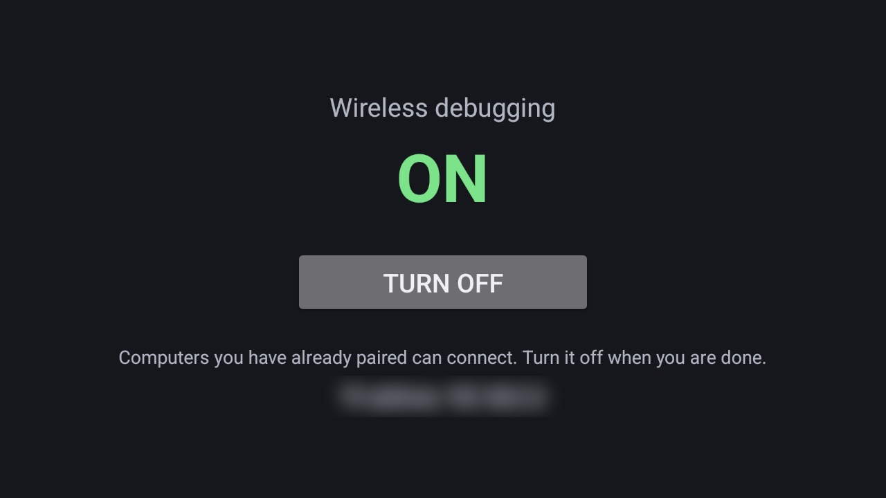

# Debug Switch

Wireless debugging on and off with one press of the remote. Android switches Wireless debugging off whenever the
TV's Wi-Fi drops, which standby does, so the next `check.py` or `adb connect` means going back to Developer options
with the remote. This app is one screen: ON or OFF in large type, one button, and while it is on, the address a
paired computer connects to. For the [Clean Your TV](../../README.md) launcher it declares a
[module card](../../docs/modules.md): once you answer **Show card** its tile reads "Debug Switch" with a green glow.
On any other Android TV home it is an ordinary app.



| On screen | What it does |
|---|---|
| **ON / OFF** | Whether Wireless debugging is on now. It follows the setting while the screen is open, so it also shows Android switching it off by itself. |
| **Turn on / Turn off** | Focused first. OK switches Wireless debugging. |
| **The line below** | What that means: paired computers can connect, it is closed, Android needs Wi-Fi for it, or the command to run when the permission isn't granted yet. |
| **Address** | The TV's address; while it is on, `adb connect <tv ip>:<port>` when the TV lets apps read the port. |

## Why switching it on is safe enough

- **It lets nobody new in.** A computer that has not paired before still needs the six-digit code from
  Developer options → Wireless debugging → Pair device with pairing code. Only computers already paired reconnect.
- **It is Wireless debugging, not port 5555:** encrypted, and tied to paired keys.
- **Android still asks** "Allow wireless debugging on this network?" on a network it has not been allowed on.
- **It shortens the time ADB is open:** on for a check, off with one press, instead of left on between checks.
  Turning it off closes the Wireless debugging port, which switching USB debugging off leaves open.

## Permissions

| Permission | Why |
|---|---|
| `ACCESS_NETWORK_STATE` | Whether the TV is on Wi-Fi, and its address. |
| `WRITE_SECURE_SETTINGS` | Only to switch Wireless debugging on and off. Android lets only ADB grant it; `install.sh` does. Without it the button is greyed out and the screen shows the command. |

It reads and writes one setting, `adb_wifi_enabled`, the one Developer options → Wireless debugging writes, and
reads the `service.adb.tls.port` property for the port. It changes nothing unless OK is pressed. No internet
permission: nothing leaves the TV. No background service, start at boot, accounts, telemetry, ads or libraries.

## Build and install

JDK 17 and Android SDK platform 34 with build-tools 34.0.0, as for the launcher. From the repo root, with ADB on:

```bash
TV_HOST=<tv ip> addons/debug-switch/install.sh
```

On a TV that offers only Wireless debugging, connect with the stock `adb` first and run it through that
connection, as [`tools/native-adb.md`](../../tools/native-adb.md) describes:
`TV_ADB_BINARY=adb TV_HOST=<tv ip>:<port> addons/debug-switch/install.sh`.

It builds the add-on, installs it, grants the permission for the button, and opens it. To build only:
`cd addons/debug-switch && ./gradlew assembleRelease`; the JVM tests run with `./gradlew testReleaseUnitTest`.

To remove it: `adb shell pm uninstall io.github.gkudva96.debugswitch`. The grant goes with it.

## Limits

- **Android 11 and newer** (`minSdk` 30): Wireless debugging arrived in Android 11.
- **Wi-Fi only.** Android starts Wireless debugging only on Wi-Fi and turns it off when the TV changes network or the
  Wi-Fi drops. A TV on Ethernet needs the vendor's Network debugging (port 5555), which this app does not switch.
- **It needs one ADB connection** to be granted, so it can't help a TV whose debugging can't be reached at all.
- **The port** comes from the `service.adb.tls.port` property, which some firmware doesn't set or hides from apps
  (the test TV doesn't set it, not even for the ADB shell). The address line then shows the TV's address alone,
  and `adb mdns services` finds the port.
- **The grant covers the main user.** On a TV with a second profile, run the grant for that user too.

## Tested on

TCL Smart TV Pro (Google TV, Android 14), on Wi-Fi, installed with `install.sh` over Wireless debugging (`TV_ADB_BINARY=adb`). With the
remote: OK switched Wireless debugging off (its mDNS advertisement went within seconds) and OK again switched it
back on, on a new port, where the paired computer reconnected with `adb connect` and no new pairing. The same
switch, in an earlier build, has brought ADB back after real standbys. The JVM tests cover the hints, the port
property and the address.

## Maintainer

[@gkudva96](https://github.com/gkudva96)
