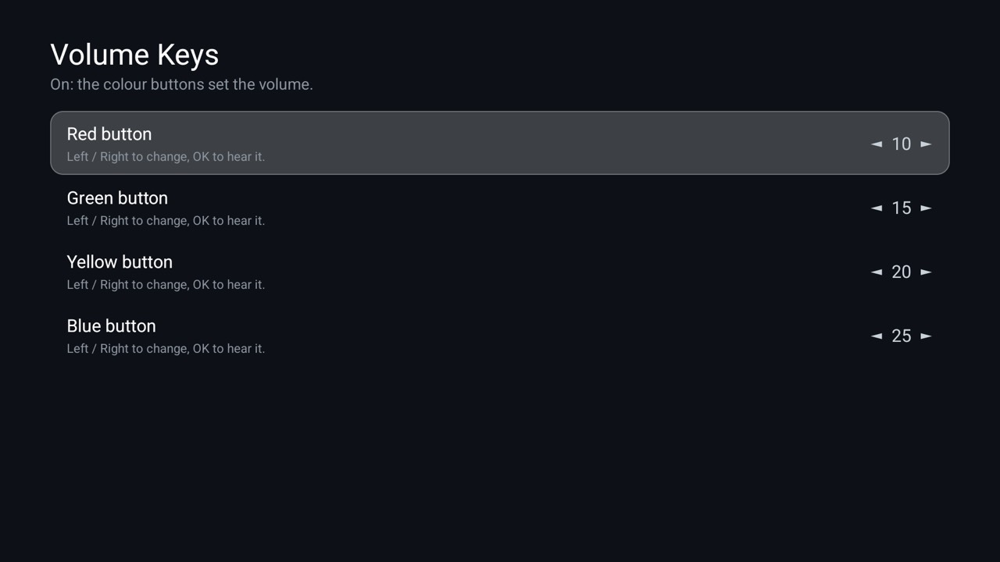

# Volume Keys

The Red, Green, Yellow and Blue buttons are for teletext and unused on most TVs. This add-on makes each one set
the volume to a level you choose: 10, 15, 20 and 25 to start with. One screen lists the four buttons; Left and
Right change a level (hold to run), OK sets the volume to it so you can judge it by ear. The change takes effect
at once, with no rebuild and no restart. For the [Clean Your TV](../../README.md) launcher it declares a
[module card](../../docs/modules.md): once you answer **Show card** its tile reads "Volume Keys" with a green
glow. On any other Android TV home it is an ordinary app.

It sets the media volume through Android's normal volume call, with the TV's own volume bar. On a TV whose
firmware ignores that call it does nothing (the Philips it was made on accepts it; `adb shell cmd media_session
volume --set` is ignored there, an app's call is not).

## Install

`TV_HOST=<tv ip> addons/volume-keys/install.sh` builds it, installs it and grants the one permission. Opening the
app switches its key service on.

## Permissions

| Permission | Why |
|---|---|
| `WRITE_SECURE_SETTINGS` | Only to switch on this app's own key service when the app is opened. Android lets only ADB grant it; `install.sh` does. Without it, turn the service on in Settings > Accessibility. |

It runs one accessibility service that sees key presses, to catch the four colour buttons, and ignores every other
key and all screen content (no accessibility events are subscribed to). The levels are stored in the app's own
preferences. No internet permission: nothing leaves the TV. No telemetry, ads, accounts or libraries.

A key-filtering service means a held Volume button moves one step per press on some firmware.
