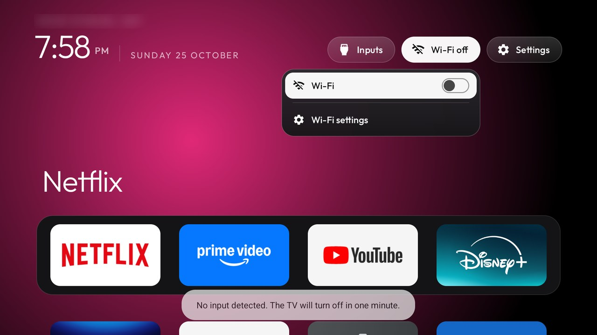

# Wi-Fi switch

A tiny helper that lets the launcher's Wi-Fi drop-down (`wifi_menu`) **switch Wi-Fi on and off** and **join a
network with its password**, right from the drop-down. It has no screen, no service and no network access of its
own: it is two broadcast receivers the launcher calls.



## Why it exists

Android 10 and later refuse `WifiManager.setWifiEnabled` and `WifiManager.addNetwork` from apps that target
them; only system apps and apps built for **Android 9 (target SDK 28)** may still call them. The launcher targets
SDK 34 and should stay there, so this job lives in its own small app that targets 28 and does nothing else.
Without it, the drop-down still works: its switch and its networks open Android's Wi-Fi settings instead.

## Install

```bash
TV_HOST=192.168.1.50 addons/wifi-switch/build-and-install.sh
```

Then turn it on in your theme's `config.json` and push the theme (`tools/theme.sh`):

```json
{
  "wifi_menu": true,
  "wifi_helper": "io.github.cleanyourtv.wifiswitch"
}
```

Uninstall with `--uninstall` (or `-Uninstall` on Windows).

## How the launcher calls it

Two explicit broadcasts to this package:

| Action | Extras | Does |
|---|---|---|
| `io.github.cleanyourtv.wifi.SET` | `on` (boolean; without it, flips) | `setWifiEnabled(on)` |
| `io.github.cleanyourtv.wifi.CONNECT` | `ssid`, `security` (`open`, `psk` for WPA/WPA2, `sae` for WPA3), `password` | Adds the network and joins it |

The password is used only to build the network's configuration for Android; it is never logged or stored by this
app. Enterprise (802.1X) networks aren't supported: the drop-down sends those to Android's Wi-Fi settings.

## Permissions

- `ACCESS_WIFI_STATE`: to read whether Wi-Fi is on.
- `CHANGE_WIFI_STATE`: to switch Wi-Fi and add the network the person picked.

No location, no network access, no background service, no telemetry. Target SDK 28 on purpose (see above);
`minSdk` 26 like the launcher.

## Things to know

- Switching Wi-Fi off also drops ADB over Wi-Fi. Switch it back on from the drop-down before running `tools/`
  scripts again.
- The drop-down's network list needs the launcher's location permission and location switched on: Android hands
  scan results to apps only then. With location off, it shows "Searching for networks…".

Tested on a Sony BRAVIA KD-55X75K (BRAVIA_VU3), Google TV 14, build UKR1.240726.001.
