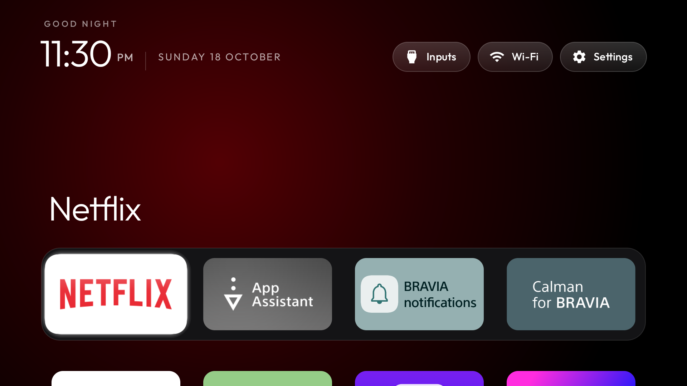

# Interruptible dock focus transitions

The dock interpolates its ambient colour over 360 ms using the platform ValueAnimator and
ArgbEvaluator. A new focus request starts from the current displayed colour. Setting
`animate_ambient_color=false` keeps the earlier fade-out/change/fade-in behaviour.

Outstanding colour, alpha and title animations are cancelled when they are superseded, when
the dock is hidden, and when Home pauses. Returning quickly to the same displayed label resets
its alpha and translation and retargets the ambient colour rather than leaving stale callbacks.
No vendor package, dependency, permission, network work or background service is introduced.

## Validation scope

Sony K-85XR70 (China), Android 14/API 34, firmware 114.602.170.1.

| State | Validation |
| --- | --- |
| Colour interpolation, cancellation and fallback before final title cleanup | SDK compilation, APK signature check and isolated real-TV navigation/Settings-return checks on 18 October 2026 |
| Final hero-title callback cleanup | SDK compilation and signature verification on 19 October 2026; awake-TV check pending |
| Gradle wrapper / lint / low-memory TVs / sustained use | Not verified |

The isolated application ID had no HOME filter and did not replace the working launcher.
At the 03:00 follow-up the TV reported Asleep. No wake or power command was sent. The temporary
test package was removed and the original working HOME resolver and version were checked.

The last short sample **before the final title cleanup** recorded 292 frames, 0 reported janky
frames, frame-time p95 8 ms, GPU-time p95 4 ms, and 88,816 KiB PSS (about 86.7 MiB) after navigation.
The sample used eighteen Left/Right keys, with 0.12 seconds between keys. It is neither a
comparative performance improvement nor a sustained benchmark or a 1 GB device guarantee.
The sanitized summary is [ambient-colour-sample.json](ambient-colour-sample.json).

The image below is from that earlier measured state. The missing title is the rapid-return
callback observation that prompted the final cleanup; it is not an after-fix screenshot.

## Remaining device check

On an awake TV, build the final source with a separate application ID and no HOME registration.
Rapidly move Right/Left back to the initial app, then stop: the matching title should remain
visible and the background should settle to that app's colour. Repeat after entering/leaving
the grid and returning from system Settings; repeat with colour interpolation disabled.
Confirm the working HOME stays unchanged and remove the temporary test package afterward.
