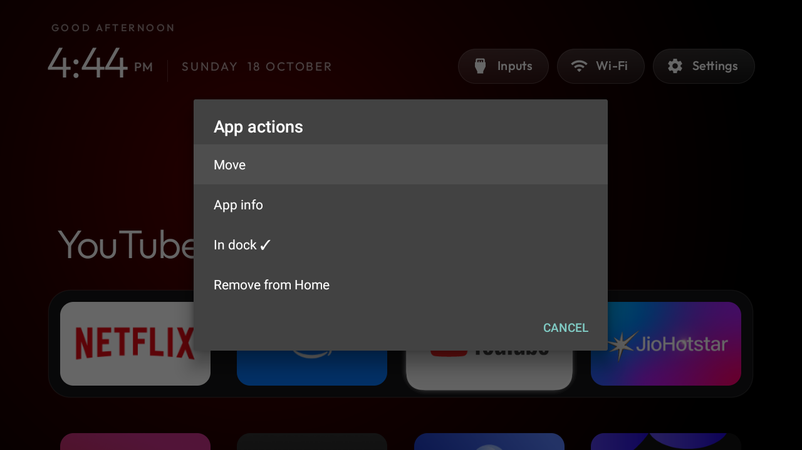
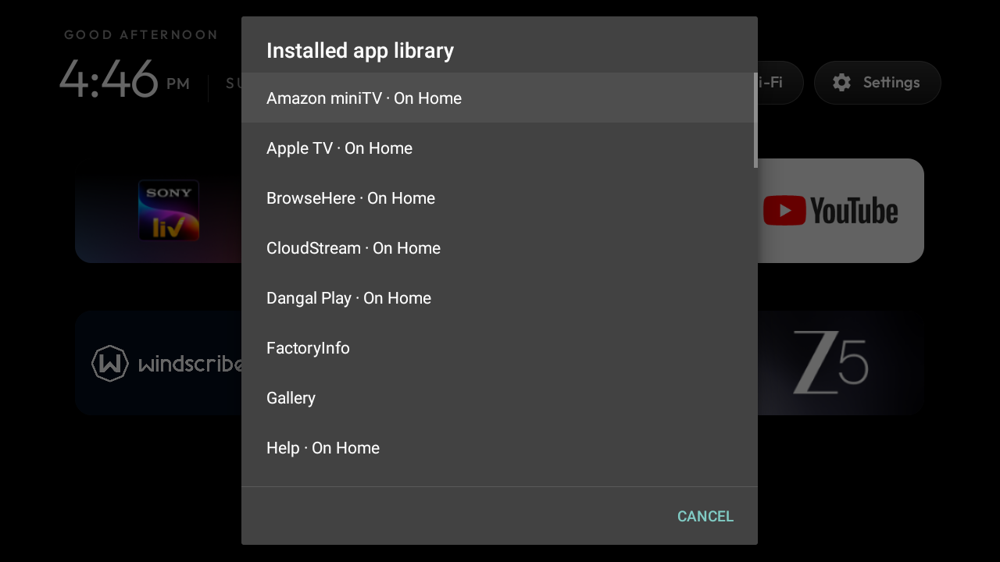
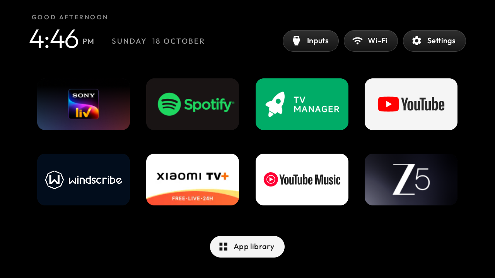

# App library and dock editing

The app library includes installed activities advertised through `LEANBACK_LAUNCHER` or
`LAUNCHER`, with each package shown once. It does not try to launch background-only packages.
Resource defaults in `config.xml` stay unchanged. Explicit user choices can add back a default
hidden app, remove a shortcut, leave a dock slot empty or replace a dock app from the library.

Long-press actions and library choices use native, scrollable dialogs. App order, dock slots,
hidden shortcuts and explicitly added apps are saved in the launcher's private preferences.
Move cancellation restores the in-memory order without saving the move.

The full-width library footer consumes Down at the bottom, and Up returns to the last app row.
Focus restoration uses the most recent request when scrolling or rebinding. The original glass
spring settings remain 260 stiffness and 0.58 damping; a small helper synchronises its absolute
destination with the focused card after layout changes.

## Validation

Target hardware: Redmi MiTV-AXFR0, Android 11/API 30,
`RTT0.210630.002.2318 release-keys`. The feature is built without new permissions or dependencies.
The completed TV test used a temporary application ID with its Home intent filter omitted, so
the owner's installed Home and preferences remained separate. After testing, the temporary app
was removed and the original Home default and saved choices were verified.

Eight checks passed on 18 October 2026:

- Cancel a move and restore focus to the selected app.
- Save a move and verify the persisted order.
- Remove a dock shortcut and leave an Add app slot.
- Restore that hidden app from the full installed-app library.
- Replace a dock slot with another installed app.
- Preserve saved choices across a Settings/launcher return.
- Press Up from the library footer after idle.
- Navigate to the top and bottom with the D-pad.

To reproduce, use the remote to move a dock app, cancel and repeat with save; remove that app
from Home, select its empty slot and restore it from App library; replace it with a grid app.
Open Settings and return to check persistence, then navigate to the footer and press Up after
waiting for scrolling to stop. Perform these checks with the remote otherwise idle.

The repository already targets API 29 and contains an API-28 font style with minimum API 26,
and its Home activity has no Leanback app entry. These existing conditions trigger three lint
errors (`NewApi`, `ExpiredTargetSdkVersion`, `MissingLeanbackLauncher`); this branch also reports
26 warnings. Normal and isolated debug APK assembly both pass. `git diff --check` passes.
Play Protect also warns about the old target on a fresh test installation. Target SDK migration
and existing font/manifest lint issues require separate compatibility work.
