# Hisense launcher customizations (2.10)

This branch adds an app-management menu and persistent Home ordering to the lightweight launcher.
It was built and tested on a Hisense SmartTV 4K FFM (`lushan`) running Android 12.

## Header dropdowns in 2.10

Inputs and Wi-Fi share a translucent surface based on the dock colors, rounded
corners, typography and inset selection rows. Each 256 dp wide list aligns with
its button's right edge, opens 10 dp below it, and scrolls within a 216 dp height
so it stays above the dock title. Back returns focus to the originating button.

Wi-Fi lists nearby networks, merges duplicate access points by SSID and security,
sorts the connected network first and then by signal strength, and provides a
manual refresh and network-settings shortcut. Android requires location access
and location enabled for scans; the UI handles missing permission, Wi-Fi off,
empty results and scan throttling. A scan is requested only on opening or manual
refresh. The broadcast receiver and single scan timeout are removed on dismissal
or leaving Home. There is no background service or periodic scanning.

On Android 11+ implementations with a dedicated `ACTION_WIFI_ADD_NETWORKS`
handler, personal WPA2/WPA3, open and OWE networks can be proposed to Android for
user confirmation. Passwords are not saved by Home and the field is cleared when
the dialog closes. Enterprise/legacy security uses system settings instead.

**Hisense limitation:** this TV resolves that action to
`com.android.tv.settings/.connectivity.NetworkActivity`, the generic network page.
It does not provide the proposed-network confirmation flow. Home therefore shows
the available networks but delegates the final selection and password entry to
Android settings, with an explicit explanation. It does not collect a password
that this TV cannot use. The dedicated confirmation branch cannot be exercised
on this device. See Android's [save-network API](https://developer.android.com/develop/connectivity/wifi/wifi-save-network-passpoint-config).

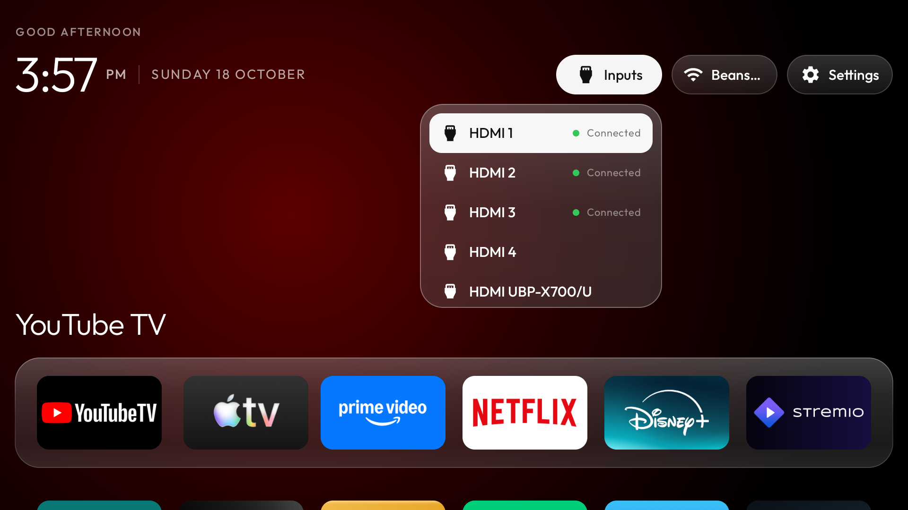

Validation: `assembleDebug` succeeded. On-device checks covered list scrolling,
Back/focus restoration, repeated opening and closing, Wi-Fi results, and delegation
of a selected nearby network to Android settings without changing the active
connection. Saved app order and hidden packages were unchanged. `lintDebug` is
blocked by 41 existing project errors (including the missing Leanback launcher
filter, drawable/color resource typing and older API resource attributes); no
findings remain in the two new Java classes. The new strings include English,
Spanish and German translations.

## Header and app-title alignment in 2.9

The greeting, clock and selected app title share the dock's 16 dp left margin.
Settings ends at its matching right margin. The three header buttons retain their
equal dimensions and spacing, with their centers aligned to the clock details.
The app title uses 32 sp text and places its visible bottom 24 dp above the parked
dock, including labels with descenders. It stays anchored while cards zoom and
when returning from the header. The dock and card geometry are unchanged.

This uses existing text views and layout calculations, without new images,
dependencies or continuously running effects.

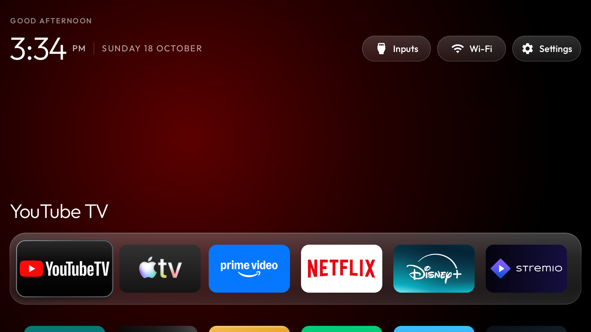

## Remote control

- Hold **OK** on an app: the tile zooms and a contextual menu opens.
- **Move**: use the arrows to swap positions; press OK to save or Back to cancel.
- The first six visible apps make up the dock. Apps can move between the dock and the grid.
- **Uninstall**: opens Android's uninstall confirmation. System apps are kept intact and show an explanation instead.
- **Hide**: removes an app from Home without disabling or uninstalling it.
- Focus **Settings** and press **Right five separate times** to open the hidden-app dropdown.
- Press OK on a hidden app to open it while keeping it hidden from Home.
- Hold OK on a dropdown item to show it on Home again. Back closes the list.

The order and hidden-app list are saved locally. Newly installed apps appear after the saved order.
Leaving Home cancels a pending move. English and Spanish resources are included; the system language selects them.
The contextual menu uses dimming, rounded panels, vector icons and scale animation without real-time blur or new dependencies.

## Visual corrections in 2.3

Inputs, Wi-Fi and Settings use equally sized pills, equal gaps and centered icon/label groups.
The greeting and clock share their starting edge. Each app card now owns its inset glass highlight,
so the artwork and rim share clipping, rounded corners and scale animations. The contextual preview
uses the same highlight and continues from the scale reached while holding OK.

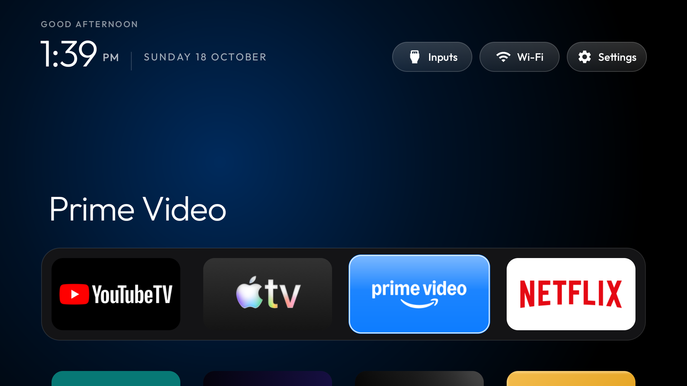
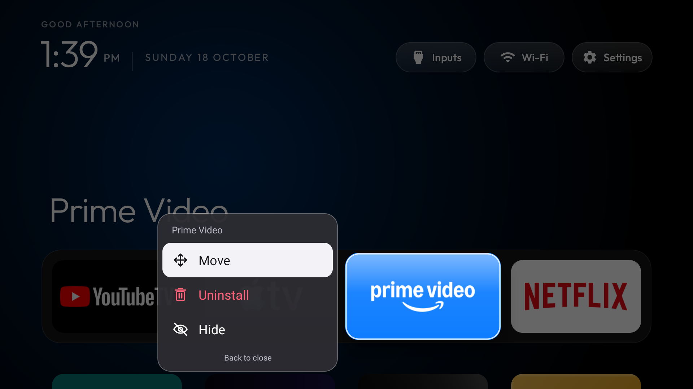

Verified on the TV: the three header pills each measured 224 by 84 screen pixels,
with 20-pixel gaps and the same vertical position. Checked the input menu, Wi-Fi,
Settings, focused cards and contextual previews. The app order was unchanged.

### Edge clipping fix in 2.3.1

The grid viewport extends 24 dp farther on each horizontal side, with matching internal padding.
This preserves card positions, column spacing and dock geometry while leaving room for the 1.2x long-press scale.
Vertical clipping remains enabled to keep scrolling apps out of the header.
Verified first and last columns in the dock and app grid, including the long-press menus;
the saved app order was unchanged.

### Menu opening fix in 2.3.2

The contextual panel starts transparent and receives its final bounds synchronously in `onLayout`,
before its opening animation starts. Its position no longer depends on a posted callback and a second
layout pass, preventing an initial flash at the screen origin. The preview also starts at the held tile's scale.
Recorded long-press openings at both dock edges on the TV and checked all 238 recorded frames;
the menu did not appear in the empty top-left region beside the clock.

## Hidden-app dropdown in 2.4

The minimal, scrollable list opens below Settings and is aligned with its right edge.
Five consecutive Right key presses while Settings is focused replace the previous Settings long-press shortcut.
Key-repeat events from holding Right do not advance the counter. Other keys, focus changes,
leaving Home and closing the dropdown reset the sequence.
Opening an app from the list does not change its hidden status. Holding OK on a list item restores it to Home.

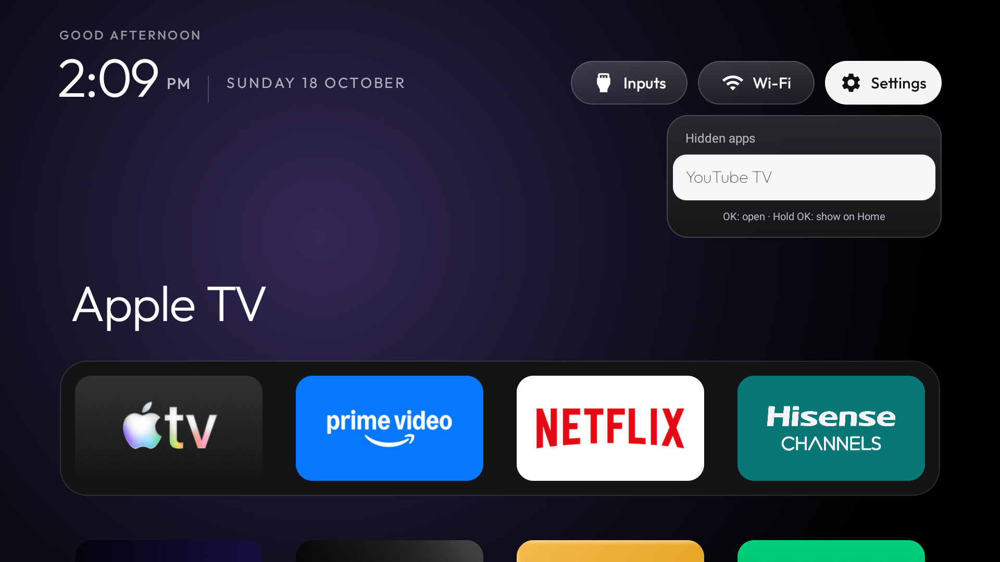

Verified on the TV: four presses keep the list closed, the fifth opens it, key repeats do not count as
additional presses, and changing buttons resets the count. Confirmed a hidden app opens while remaining hidden
and can be restored using the dropdown. After testing, the app order and hidden-app list matched their prior state.

## Translucent dock and focus halo in 2.5

The dock combines translucent graphite tint, a soft vertical reflection and a fine gradient rim.
The existing ambient background remains visible through it. The gradients are cached by dock height;
scrolling only translates them. No background capture, blur texture, dependency or continuous animation was added.
Dock placement, tile dimensions and the four-app layout are unchanged.

The focus highlight uses a finer rim, faint contour strokes and reduced surface gloss to preserve logo contrast.
Artwork is clipped inside a separate frame while the highlight has 6 dp of space on every side.
Both remain children of the same scaled card, including the contextual preview, so the halo follows focus
and long-press zoom. Focus settling has a smaller overshoot, and the hold/release scales use deceleration.

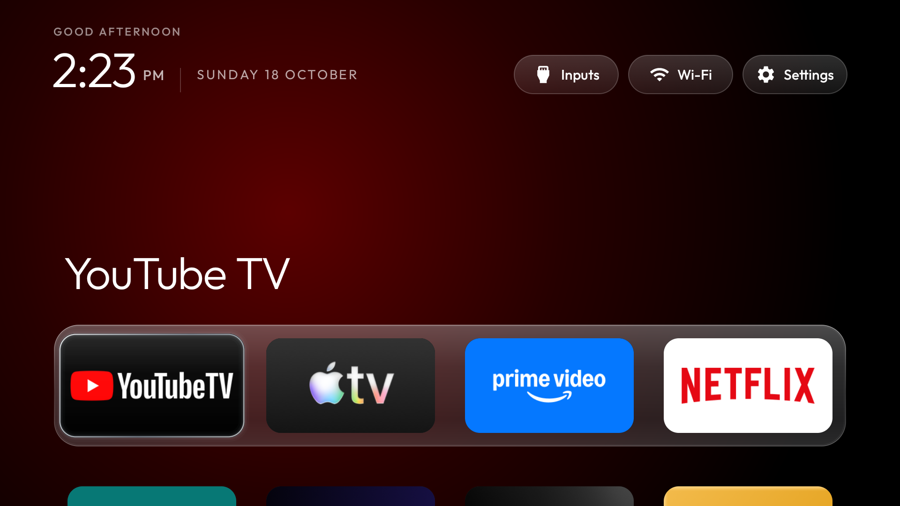
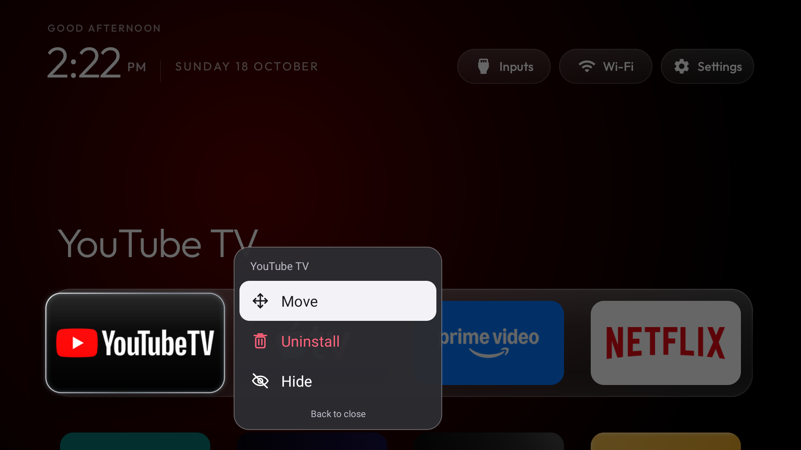

Verified on the TV: both dock edges and both edges of the next grid row, their contextual previews,
and moving an app followed by cancelling. The order and hidden-app preferences matched their initial state.
All 265 frames of the recorded dock-menu openings were checked for the previous top-left flash; none appeared.
The frame counter stayed unchanged over a three-second idle interval after navigation settled.
One memory snapshot after these interactions was about 71.5 MiB PSS; this is an observation,
not a controlled memory comparison with an earlier version.

## Six-app layout and navigation in 2.6

Home now uses six columns, with six dock slots taken from the existing saved order.
Tiles share a 124 by 70 dp frame, 12 dp corners and consistent spacing. The narrower cards leave room for
focus enlargement and the contour halo. Banners preserve their aspect ratio instead of being cropped or stretched;
fallback icons and labels share the same dimensions in Home and the contextual preview.
The dock sits slightly lower, with a small preview of the next row.

Artwork is rasterized once at a bounded size suitable for the 1.2x contextual preview. Apps with banners
do not also retain a launcher icon. Reloading Home reuses entries whose component, APK source path and label
match, avoiding repeated image loading on ordinary returns. Hidden or removed entries are not retained in a separate cache.

Arrow navigation explicitly stays within row edges and preserves columns vertically where a destination exists.
Up from the dock selects the nearest header control; Down from the header returns to the last dock slot.
A single pending-focus request follows rapid input during scrolling, rather than accumulating scroll listeners.
Row adjustments use short eased scrolls, the app title immediately follows the selected app, and the entry
animation runs only on the activity's first resume. No perpetual effects or new dependencies were added.

Verified all six dock positions, horizontal edges, vertical column mapping, rapid input through the last row,
returning from Settings, contextual menus at both dock edges, moving and cancelling across the dock boundary,
and hiding/restoring Stremio through the five-press dropdown. Saved order and hidden packages matched the original state.
The dock-menu recording contained 276 frames; none showed the previous top-left panel flash.

A single cold-start comparison on the same TV sampled Home PSS three times shortly after launch:
2.5 measured 64,048 / 68,607 / 68,674 KiB, and 2.6 measured 55,011 / 59,301 / 57,956 KiB.
The respective medians were 67.0 and 56.6 MiB. Launch times were 2.90 and 3.35 seconds in these individual runs;
this is not evidence of a startup-speed improvement or a sustained workload benchmark.
The 2.6 frame counter stayed unchanged during a three-second idle sample after startup settled.

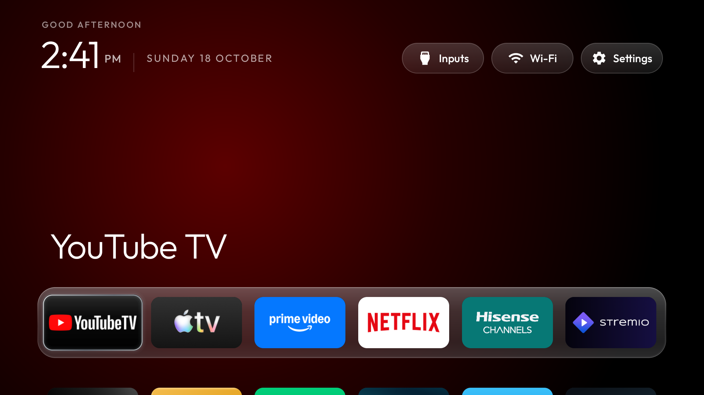
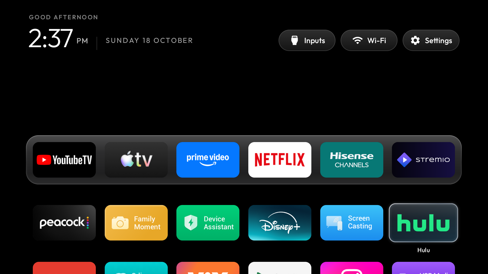

## Larger proportions and softer glass in 2.7

Cards now measure 132 by 78 dp: about 6.5% wider and 11.4% taller than 2.6.
The six-column content extends 26 dp farther on each side while the header retains its alignment.
The viewport still leaves a 24 dp inset for edge zooms. The dock covers about 95% of the tested screen width.
Corner radius, label placement, row height and highlight bounds follow the larger cards.

Focused cards scale to 1.16x and long-press previews to 1.24x. Home and the contextual preview both use
aspect-preserving center-crop fitting, lightly trimming wide banner edges to fill the taller frame without letterboxing.
The tested dock logos remain legible and intact. Existing user ordering, including replacements in the dock, takes precedence.

The highlight has a thinner, softer rim and two faint contour strokes; the dock's secondary inner rim was removed.
Cached gradients remain the only glass simulation: no bitmap blur, continuous animation or additional dependency was added.

Verified the dock and next grid row at both horizontal edges, including long-press previews and returning from the header.
Preview bounds remained inside the screen with space for the halo; the stored order and hidden-package set were unchanged.
A Home memory snapshot before interaction was 59,739 KiB PSS (about 58.3 MiB), and a settled three-second idle sample
produced no new frames. This is a point-in-time observation rather than a controlled comparison with 2.6.

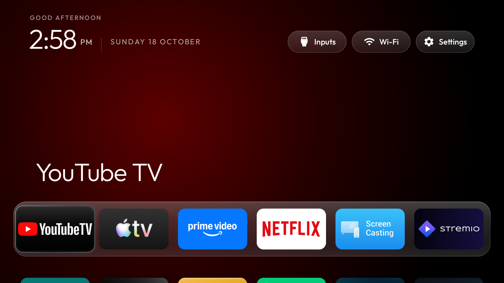
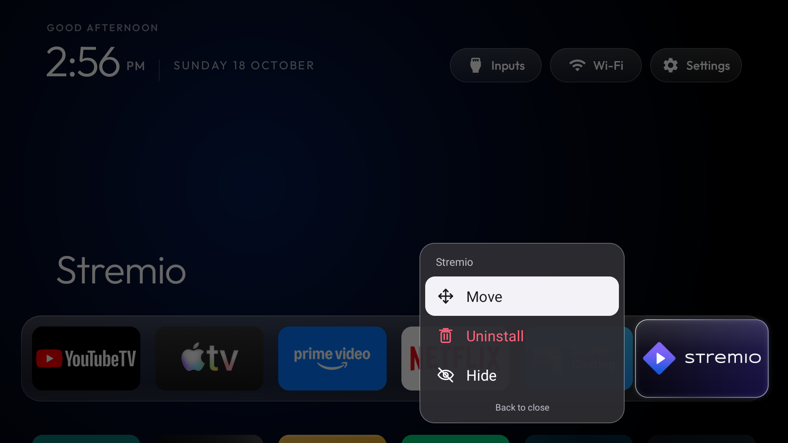

## Dock breathing room and neighbour motion in 2.8

The dock reserves 23 dp horizontally and 19 dp vertically around the unscaled card bounds.
Focused cards now grow by 20% over 200 ms, preserving their vertical centre. Together with the narrower
contour glow, the reserved area leaves roughly 8–10 dp of visible clearance around a focused edge card.
Long-press previews retain their 1.24x scale.

Only the immediate dock neighbours move 5 dp away from the selection over the same eased interval.
Their offsets reset when focus leaves the dock, on pause, and when a holder is rebound for another row.
The app order is never changed by this motion. A small native 3 dp elevation gives the selected card a shadow;
the halo uses narrower strokes instead of spreading into the surrounding gap. The existing property animations
and cached gradients remain in use; no custom blur pass, new image asset or dependency was introduced.

Verified all six focused positions, neighbour offsets, reset on the header, contextual menus at the left,
centre and right, move/cancel across rows, scrolling through recycled rows, rapid left/right input and returning
from Settings. Saved ordering and hidden packages matched the pre-update state.
Dock edge detection in screenshots at the left, centre and right returned identical pixel coordinates
for all four edges. A settled three-second idle sample produced no new frames.

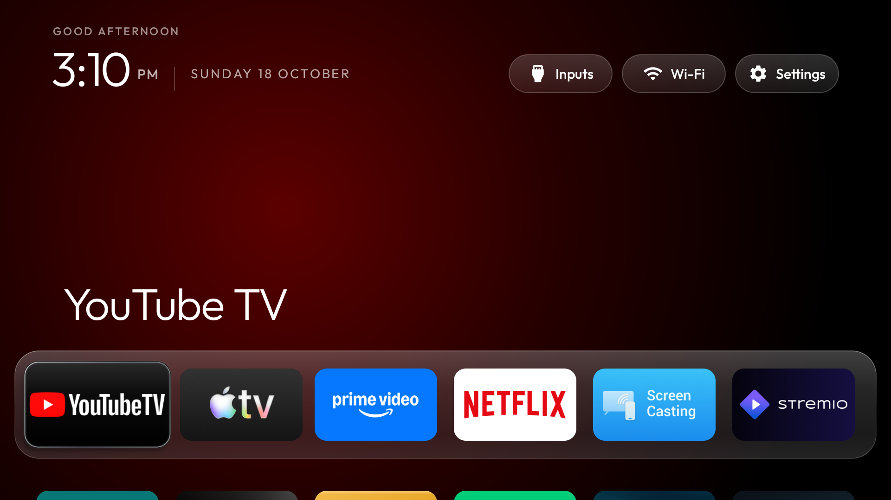
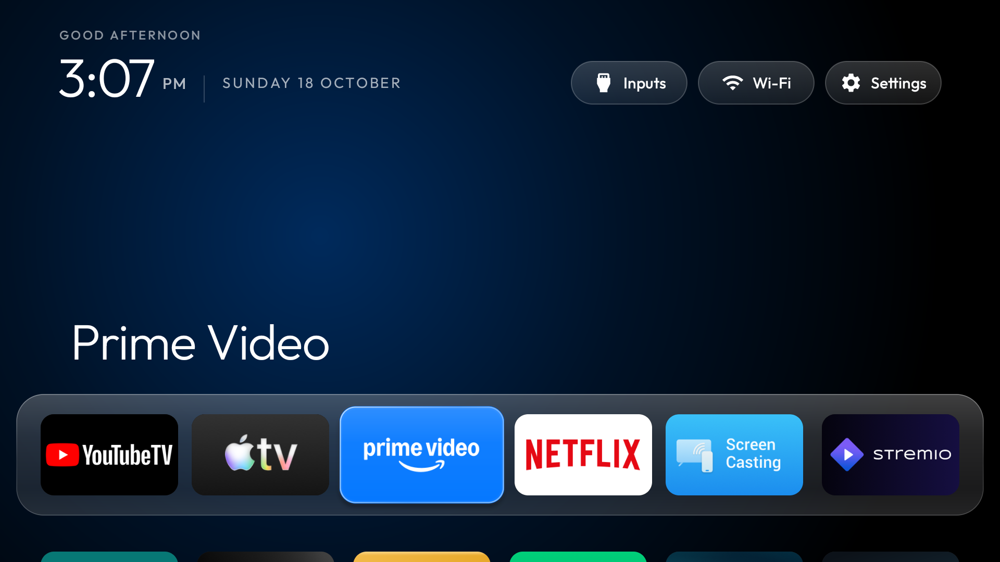

## Hisense configuration

`launcher/app/src/main/res/values/config.xml` sets the initial dock to YouTube TV, Apple TV, Prime Video,
Netflix, Hisense Channels and Stremio. An existing saved order takes precedence.
The Live TV package is `com.vt.tv.tvcenter` for the tested device. Change it for other TV models.

The tested TV also exposed a higher-priority Home recovery activity from `com.google.android.tungsten.setupwraith`.
Selecting the custom Home alone was insufficient on this device. After installing and opening the new launcher,
both `com.google.android.apps.tv.launcherx` and `com.google.android.tungsten.setupwraith` were disabled for user 0.
The latter contains Google TV setup features: restore it before using those features. This is a device-specific observation,
not an instruction to disable the package on every TV.

To restore Google TV on the tested model, with an authorized ADB connection:

```sh
adb shell pm enable --user 0 com.google.android.apps.tv.launcherx
adb shell pm default-state --user 0 com.google.android.tungsten.setupwraith
adb shell cmd package set-home-activity --user 0 com.google.android.apps.tv.launcherx/.home.HomeActivity
adb shell input keyevent KEYCODE_HOME
```

## Validation

- `assembleDebug` succeeded using JDK 17, Android SDK 34 and build-tools 34.0.0.
- Installed on the real TV; verified Home, the six dock tiles, Settings and the HDMI/AV/Live TV menu.
- Verified move, cancel, save and order persistence after stopping and reopening the launcher.
- Verified hide persistence after process restart and recovery through Settings.
- Verified Android's uninstall confirmation and cancelled it; no apps were removed during testing.
- Confirmed the saved order matched the pre-update order after the tests.

Network addresses, ADB keys, device dumps, accounts and local build paths are not part of this branch.

Validation for 2.9: built and installed on the Hisense; checked the visible title position for all six dock apps, equal header button bounds and gaps, navigation between the header and dock, and return from native settings. Saved app order and hidden packages were unchanged.
