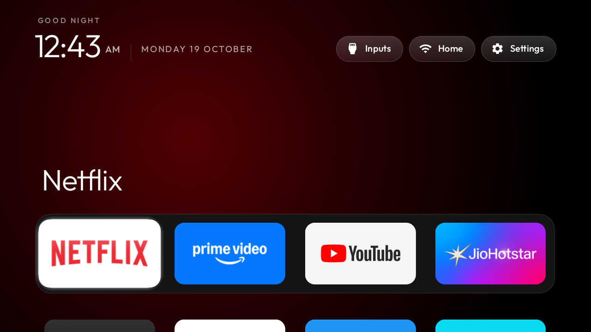

# OnePlus Y1 43" (Y Series, shibuya)

Complete consumer guide and configuration hub for debloating the OnePlus Y1 43" TV and installing the clean Apple TV-style home screen.



---

## Hardware & Firmware Specifications

- **Brand & Model**: OnePlus TV (Y Series 43" Full HD)
- **Codename / Device**: `shibuya` (Board: `m7221`)
- **Operating System**: Android TV 11
- **Firmware Build ID**: `RTO9.231122.002`
- **Stock Launcher**: `com.google.android.tvlauncher`
- **Live TV Tuner Package**: `com.mediatek.wwtv.tvcenter`
- **RAM**: 1 GB (Debloating significantly improves responsiveness and eliminates frame drops)

---

## Quick Start (Debloating)

### 1. Enable USB Debugging on the TV

1. On the TV, navigate to **Settings** → **Device Preferences** → **About**.
2. Scroll to **Build** and press the **OK** button on the remote 7 times until you see the message "You are now a developer!".
3. Go back one menu to **Device Preferences** → **Developer options**.
4. Turn on **USB debugging**. Keep the TV turned on.

### 2. Connect and Apply Debloat List

From your computer on the same Wi-Fi network:

```bash
# 1. Setup Python ADB environment (one time)
python3 -m venv tools/venv && tools/venv/bin/pip install -r tools/requirements.txt

# 2. Set your TV IP address
export TV_HOST=192.168.1.82

# 3. Probe connection and accept "Allow USB debugging?" prompt on TV screen
tools/venv/bin/python -I tools/tv.py --probe

# 4. Apply the OnePlus Y1 debloat profile
tools/disable.sh examples/oneplus-tv-y1/debloat.txt
```

All selected packages are **disabled for user 0**, never uninstalled. The underlying Android firmware remains 100% untouched.

---

## Restoring to Factory State

If you ever wish to re-enable all original packages and switch back to the stock Google TV launcher:

```bash
# Option A: One-command dedicated restore script
TV_HOST=192.168.1.82 examples/oneplus-tv-y1/restore.sh

# Option B: Generic repository restore tool
TV_HOST=192.168.1.82 tools/restore.sh examples/oneplus-tv-y1/debloat.txt com.google.android.tvlauncher
```

---

## Launcher Configuration

The clean native launcher (`launcher/`) integrates with the OnePlus hardware tuner. Ensure the following value is set in [`launcher/app/src/main/res/values/config.xml`](../../launcher/app/src/main/res/values/config.xml):

```xml
<!-- Live TV / Tuner input for MediaTek-based OnePlus Y1 -->
<string name="live_tv_package">com.mediatek.wwtv.tvcenter</string>
```

Build and install the launcher to the TV with:

```bash
TV_HOST=192.168.1.82 launcher/build-and-install.sh
```

---

## Preserved Features & Verified Functionality

The following hardware and operating system capabilities have been tested and verified to work without degradation:

- **HDMI Switching**: HDMI 1, HDMI 2 (ARC), and AV input switching work seamlessly via the Inputs frosted button.
- **Remote Control**: Bluetooth voice remote pairing, volume controls, mute, and power control function normally.
- **Voice Assistant**: Google Assistant (`com.google.android.katniss`) microphone searches remain fully active.
- **Chromecast Built-in**: Media casting via Google Cast (`com.google.android.apps.mediashell`) functions normally.
- **Google Play Store**: App downloads, updates, and authentication remain untouched.
- **On-Screen Keyboard**: Default Gboard / LatinIME input remains active and functional.

---

## Model Utilities

This directory includes helper utilities tailored to the OnePlus Y1:

- **[`classify_packages.py`](classify_packages.py)**: Audits your installed packages from `backup/packages_all.txt` and groups them into Definite Bloat, Discretionary Streaming/Assistant apps, and Critical Hardware Core. Run with:
  ```bash
  python3 examples/oneplus-tv-y1/classify_packages.py
  ```
- **[`generate_restore_script.sh`](generate_restore_script.sh)**: Generates a self-contained restore script from a debloat list. Run with:
  ```bash
  examples/oneplus-tv-y1/generate_restore_script.sh
  ```
