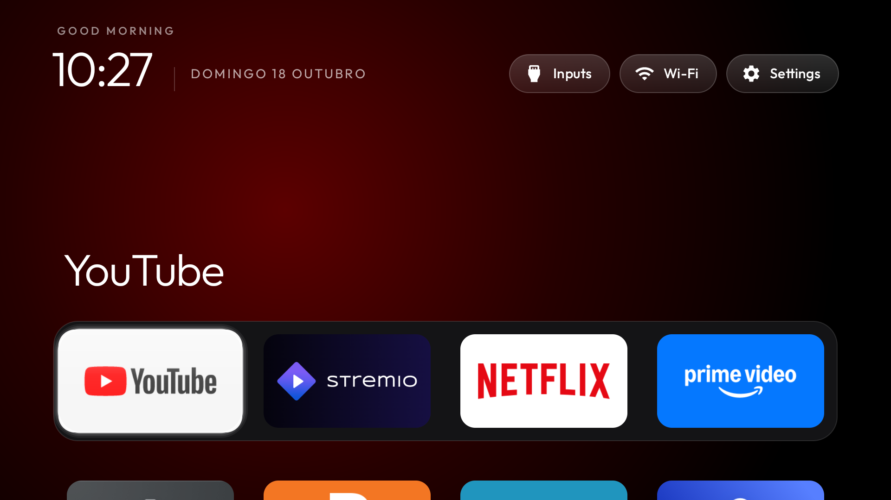

# TCL C6K (G08), Google TV / Android 14 — experimental

Tested on a TCL C6K in Brazil on 2026-10-18. ADB identifies it as:

| Property | Observed value |
|---|---|
| Manufacturer / model | TCL / `Smart TV Pro` (retail model C6K) |
| Device | `G08` |
| Android / SDK | 14 / 34 |
| Software version | `V8-T653T01-LF1V643` |
| Product / SoC | `G08_4K_GB` / MediaTek `MT9689` |
| Build display ID | `tcl9618-user 14 UTT2.250416.001 AU02 release-keys` |
| Stock Home activity | `com.google.android.apps.tv.launcherx/.home.HomeActivity` |
| Setup / recovery package | `com.google.android.tungsten.setupwraith` |
| Live TV app | `com.tcl.tv` |
| TV input provider | `com.tcl.tvinput` |

**Same-day launcher testing only.** This is not a validated C6K debloat list and
must not be applied to the G10/Realtek TCL example or every TCL firmware. No
`debloat.txt` is included: CONTRIBUTING requires several days of real use first.
Re-probe your TV and inspect its packages before using this workaround.

## What differs on this firmware

`set-home-activity` returned `Success`, but resolving HOME still selected Google TV
(priority 2). Disabling only Google TV then exposed the setup app's
`.RecoveryActivity` (priority 1), which interfered again when returning from an app.
Disabling **both** packages for user 0 allowed the custom launcher to handle Home.
Changing just the recovery activity's enabled state was rejected by Android with
`SecurityException`; these scripts do not attempt component changes.

The setup package also contains initial-setup and account-linking activities.
Re-enable it before using those functions. This tradeoff is specific to the
observed firmware, not a recommendation to debloat Google setup generally.
The scripts never uninstall anything. `restore.sh` re-enables both packages and
returns to Google TV; it does not restore a different third-party Home or arbitrary
prior package-enabled states. Keep ADB enabled until you have checked restoration.

Keep `com.tcl.tv` and `com.tcl.tvinput`; they provide tuner/input functionality.
Do not disable remote, pairing, keyboard, Play Store, Play Services, assistant,
casting, firmware-update, or streaming packages based on this example. None of
those services was disabled as part of this launcher test.

D-pad note: at horizontal row boundaries, upstream Android focus traversal can
leave the row for the app grid or top bar instead of staying on the last tile.
This was observed during edge checks. This example keeps upstream navigation and
appearance; it does not include a separate TCL theme or navigation redesign.

## Build and preview first

Use the JDK 17 / Android SDK 34 prerequisites from the main README and create
`tools/venv` with `tools/requirements.txt`. Set the TV's address locally:

```bash
export TV_HOST=<tv-ip>
# Optional when the environment is elsewhere, e.g. on Windows:
# export TV_PYTHON=/absolute/path/to/venv/python
PY="${TV_PYTHON:-tools/venv/bin/python}"
"$PY" -I tools/tv.py --probe
```

Save your current launcher config, then copy the TCL example into the usual
configuration location. The dock entries are examples, not required apps.
Keep four columns with the upstream tile dimensions; edit the apps to your taste.

```bash
mkdir -p backup/tcl-c6k
cp launcher/app/src/main/res/values/config.xml backup/tcl-c6k/config-before.xml
cp examples/tcl-c6k/config.xml launcher/app/src/main/res/values/config.xml
# Export JAVA_HOME and ANDROID_HOME for your JDK 17 and Android SDK installations.
# Build without changing the TV's Home:
(cd launcher && ./gradlew assembleDebug)
"$PY" -I tools/b64push.py launcher/app/build/outputs/apk/debug/app-debug.apk /data/local/tmp/tvhome.apk
"$PY" -I tools/tv.py 'pm install -r /data/local/tmp/tvhome.apk'
```

**Stop unless installation prints `Success`.** If Play Protect asks for confirmation,
review the APK you built and confirm on the TV if you want to install it. A refusal
produced `INSTALL_FAILED_VERIFICATION_FAILURE` during testing. Do not disable Play
Protect to work around this, and do not disable stock Home after a failed install.

```bash
"$PY" -I tools/tv.py 'am start -W -n com.gathin.tvhome/.MainActivity'
```

Check the preview and the remote navigation before continuing. Do not use the
root `launcher/build-and-install.sh` for this workflow: it immediately switches
Home and does not handle the C6K setup/recovery package.

## Activate and restore

Once the APK is installed and you have reviewed the setup/account tradeoff above:

```bash
bash examples/tcl-c6k/activate.sh
# Return to the original Google TV Home:
bash examples/tcl-c6k/restore.sh
```

Activation checks G08, SDK 34 and current user 0, saves packages, properties, all
settings namespaces and the current Home in a private ignored `backup/` directory,
then confirms that the custom activity starts before disabling anything. It
checks Android's output (ADB shell errors may still return process exit code 0),
verifies HOME resolution and foreground activity, and attempts Google TV restoration
if activation fails after package changes. Read the script's output: automatic
restoration can also fail if the ADB connection drops. Reconnect and run `restore.sh`.
Raw backups contain device/account/network identifiers; do not attach them to a PR.

To undo the example's local config edit independently of the TV:

```bash
cp backup/tcl-c6k/config-before.xml launcher/app/src/main/res/values/config.xml
```

## Validation and limits

- Debug APK built against SDK 34 and installed over authenticated ADB.
- Custom launcher previewed before replacing Home; Home return checked from apps.
- Four-column D-pad navigation and the Inputs menu checked on the physical TV.
- Both Google packages re-enabled and stock Home resolution checked during restoration.
- No broad debloat, firmware update, factory reset, account-linking, or multi-day
  stability claims. Reboot/wake persistence still needs longer validation.



The screenshot is a real device capture; the launcher was temporarily denied its
optional location permission so the Wi-Fi pill shows a generic label instead of a
private SSID. No device dumps or ADB keys are included.
