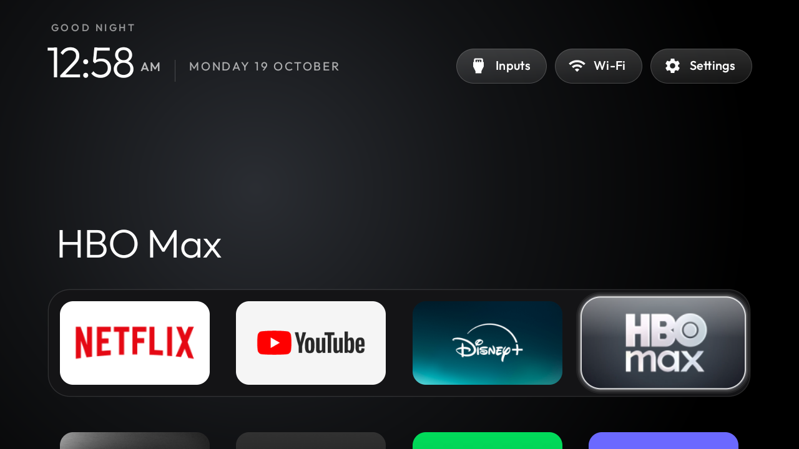

# Xiaomi MiTV-MOSR4: initial HOME compatibility report

Device: Xiaomi MiTV-MOSR4 (`irobot`), Android 11 / SDK 30, firmware
`RTM5.220609.003.1493`. Tested with repository commit `9ef40c1`.

This is a single-session compatibility report, not a debloat list validated over
several days. See [issue #49](https://github.com/Gathin23/tv-vibehack/issues/49)
for reproduction details and suggested installer verification.

## Launcher configuration

Copy this folder's `config.xml` to `launcher/app/src/main/res/values/config.xml`
before building if you want the same app selection. Missing dock apps are skipped.
The repository defaults are unchanged.

| Purpose | Package |
| --- | --- |
| Netflix | `com.netflix.ninja` |
| YouTube | `com.google.android.youtube.tv` |
| Disney+ | `in.startv.hotstar.dplus.tv` |
| HBO Max | `com.wbd.stream` |
| Live TV | `com.mitv.livetv` |



## HOME behavior observed

Setting `com.gathin.tvhome/.MainActivity` as HOME returned `Success`, but HOME
from Settings still opened `com.google.android.apps.tv.launcherx/.home.HomeActivity`.
Disabling only the Google TV package caused HOME to open
`com.google.android.tungsten.setupwraith/.RecoveryActivity` instead.

HOME candidates had priorities 2 (Google TV), 1 (Setup/Recovery), and 0 (the custom
launcher). The custom preferred activity was recorded, but the actual HOME key
still did not open it. Attempts to change the individual system HOME-component
states were rejected with `SecurityException`.

## Owner-approved workaround and restoration

On this firmware, after explicit device-owner approval, both packages below were
disabled for user 0, then the custom launcher was selected as HOME:

- `com.google.android.apps.tv.launcherx`
- `com.google.android.tungsten.setupwraith`

HOME from Settings then opened `com.gathin.tvhome/.MainActivity`.

This is device-specific evidence, not a universal recommendation. The second
package provides Google TV setup/recovery functionality. Back up package and
component states, settings and original HOME first; restore both packages before
using those setup/recovery features. Do not uninstall either package.

On this tested TV, initial setup was complete, both original package enabled states
were `default`, and the original HOME was
`com.google.android.apps.tv.launcherx/.home.HomeActivity`. The following Android
shell commands restored that recorded baseline:

```text
pm default-state --user 0 com.google.android.apps.tv.launcherx
pm default-state --user 0 com.google.android.tungsten.setupwraith
cmd package set-home-activity --user 0 com.google.android.apps.tv.launcherx/.home.HomeActivity
input keyevent KEYCODE_HOME
```

Restoration was verified by checking the foreground activity after HOME. Reapplying
the custom setup also passed. Restore your own recorded state on other devices;
these commands are not a generic backup/restore procedure.

## Validation and limits

- Debug APK built with JDK 17, Gradle 8.9 and Android SDK 34; v2 signature verified.
- Dock selection opened all four configured apps; foreground activities matched.
- Screenshots checked dock, grid, top-bar navigation boundaries and Inputs menu.
- Actual HOME from Settings and explicit restoration were tested on the TV.
- Only the two approved packages were disabled; no packages were uninstalled.
- An ADB disconnect prevented an earlier rollback. Connectivity later returned at
  the same IP; its cause was not established. No causal link to package changes was
  confirmed. A recovery procedure must report when it cannot reconnect or restore.
- Reboot persistence, video playback, HDMI switching and multi-day stability remain
  untested. No stable `debloat.txt` is provided yet, following CONTRIBUTING.md.

The report and screenshot contain no TV IP, serial, account data or ADB keys.
