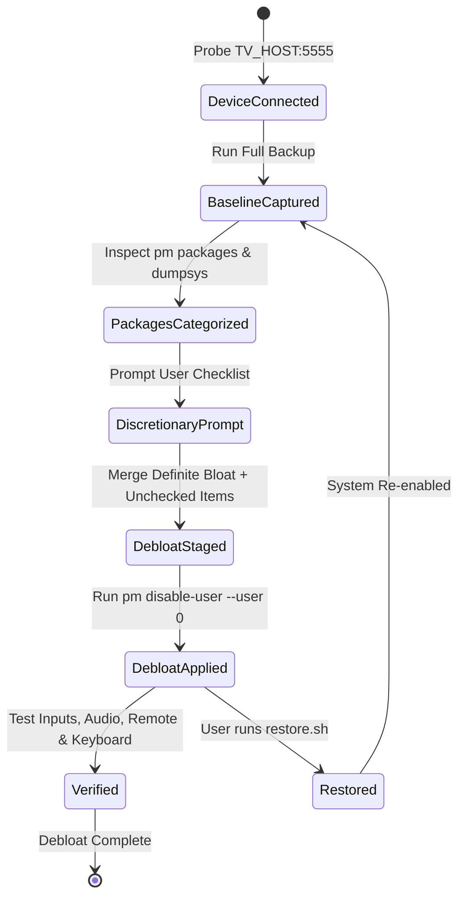
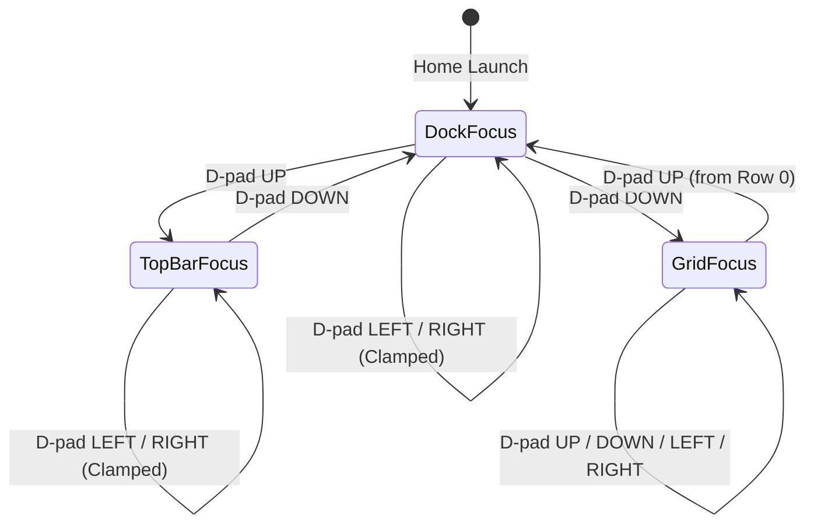

# Data Model: Android TV Debloat & Apple TV Style Custom Launcher

**Feature Branch**: `001-debloat-apple-tv-launcher`  
**Date**: 2026-10-18

---

## 1. Entities & Schemas

### Entity 1: Device Profile (`DeviceProfile`)
Represents the connected physical Android TV device and debug session state.

| Field | Type | Description | Validation Rules |
|-------|------|-------------|------------------|
| `host` | `String` | TV IPv4 address | Valid IPv4 format (e.g., `192.168.1.50`) |
| `port` | `Integer` | ADB TCP daemon port | Defaults to `5555`; range `1024-65535` |
| `model` | `String` | Product model from `ro.product.model` | Non-empty (e.g., `OnePlus TV`) |
| `android_version` | `String` | Android release version from `ro.build.version.release` | Non-empty (e.g., `11`) |
| `sdk_version` | `Integer` | Android API level from `ro.build.version.sdk` | Range `>= 26` (Android 8.0+) |
| `manufacturer` | `String` | OEM manufacturer from `ro.product.manufacturer` | Non-empty (e.g., `OnePlus`) |
| `auth_status` | `Enum` | Authorization state | One of: `UNAUTHORIZED`, `AUTHORIZED`, `OFFLINE` |

---

### Entity 2: Package Classification Item (`PackageItem`)
Represents an installed APK package on the TV and its operational category.

| Field | Type | Description | Validation Rules |
|-------|------|-------------|------------------|
| `package_name` | `String` | Android application package ID | Valid reverse-DNS name (e.g., `com.heytap.olink`) |
| `category` | `Enum` | Debloat categorization | `TELEMETRY`, `ADS_RECOMMENDATIONS`, `REDUNDANT_SERVICE`, `PRELOADED_APP`, `STREAMING_APP`, `CRITICAL_SYSTEM` |
| `is_enabled` | `Boolean` | Current package state in user 0 | `true` if active, `false` if disabled |
| `is_critical` | `Boolean` | Flag indicating package cannot be disabled | `true` for input services, remote, keyboard, Play store |
| `requires_user_prompt` | `Boolean` | Flag requiring user approval before disablement | `true` for streaming, assistant, cast, updates |
| `user_selected_keep` | `Boolean` | User checklist response | `true` to keep, `false` to disable |

---

### Entity 3: Baseline Backup Snapshot (`BackupSnapshot`)
Time-stamped archive containing full device state before any modification.

| Field | Type | Description | Validation Rules |
|-------|------|-------------|------------------|
| `timestamp` | `String` | ISO 8601 timestamp | `YYYY-MM-DDTHH:MM:SSZ` |
| `device_id` | `String` | Device identifier from `ro.serialno` or MAC | Non-empty |
| `packages_all` | `List<String>` | Full list of installed package names and APK paths | Must match `pm list packages -f -u` |
| `packages_disabled` | `List<String>` | Initial list of disabled packages | Output from `pm list packages -d` |
| `system_properties` | `Map<String, String>` | Full output of `getprop` | Non-empty dictionary |
| `settings_global` | `Map<String, String>` | Global settings table | Key-value pairs |
| `settings_secure` | `Map<String, String>` | Secure settings table | Key-value pairs |
| `settings_system` | `Map<String, String>` | System settings table | Key-value pairs |
| `restore_script_path` | `String` | Path to generated restore script | Must exist and be executable |

---

### Entity 4: Launcher Configuration (`LauncherConfig`)
Configuration model loaded from XML (`config.xml`) defining home screen appearance and layout.

| Field | Type | Description | Validation Rules |
|-------|------|-------------|------------------|
| `dock_apps` | `List<String>` | Ordered package IDs displayed in the bottom dock | Exactly 4 items; non-empty strings |
| `hidden_apps` | `List<String>` | Package IDs omitted from application grid | List of package strings |
| `live_tv_package` | `String` | Package component for Live TV / Tuner input | Valid package string or empty |
| `columns` | `Integer` | Number of columns in application grid | Integer `>= 3` and `<= 6` (defaults to `4`) |
| `font_asset` | `String` | Asset path for primary clock/greeting font | Must resolve to existing `.ttf`/`.otf` |

---

### Entity 5: TV Input Source (`TvInputSource`)
Physical or logical TV video source enumerated from `TvInputManager`.

| Field | Type | Description | Validation Rules |
|-------|------|-------------|------------------|
| `input_id` | `String` | Hardware input ID from TV framework | e.g., `com.mediatek.tvinput/.hdmi.HDMIInputService/HW1` |
| `label` | `String` | Human-readable input name | e.g., `HDMI 1`, `HDMI 2`, `AV`, `Live TV` |
| `type` | `Enum` | Input source type | `TYPE_HDMI`, `TYPE_TUNER`, `TYPE_COMPONENT`, `TYPE_COMPOSITE`, `TYPE_DISPLAY_PORT` |
| `is_connected` | `Boolean` | Hardware cable connection status | `true` if active signal detected, `false` otherwise |

---

### Entity 6: Navigation Focus State (`FocusState`)
Tracks current interactive focus location across the launcher interface.

| Field | Type | Description | Validation Rules |
|-------|------|-------------|------------------|
| `current_zone` | `Enum` | Currently focused screen zone | `TOP_BAR`, `DOCK`, `GRID` |
| `zone_index` | `Integer` | Index of focused element within zone | Non-negative integer |
| `last_grid_index` | `Integer` | Preserved focus position when leaving grid | Defaults to `0` |
| `dock_glow_color` | `Integer` | ARGB sampled color from focused dock tile | 32-bit ARGB color integer |

---

## 2. State Transitions

### Debloat Lifecycle State Machine

### Launcher Navigation Focus State Machine

