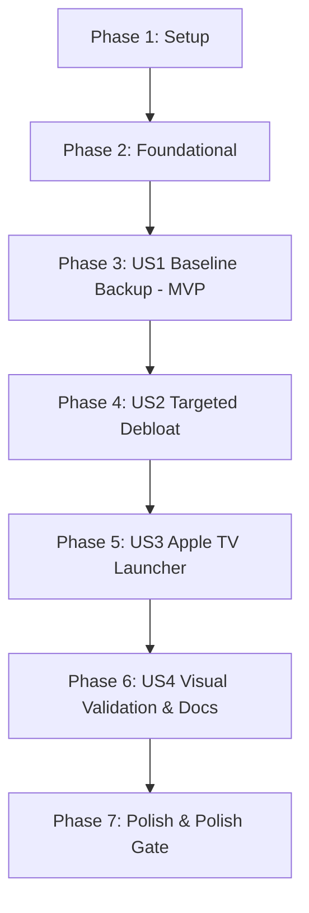

# Implementation Tasks: Android TV Debloat & Apple TV Style Custom Launcher

**Feature Branch**: `001-debloat-apple-tv-launcher`  
**Date**: 2026-10-18  
**Feature Spec**: [`specs/001-debloat-apple-tv-launcher/spec.md`](./spec.md)  
**Implementation Plan**: [`specs/001-debloat-apple-tv-launcher/plan.md`](./plan.md)  
**Quickstart Guide**: [`specs/001-debloat-apple-tv-launcher/quickstart.md`](./quickstart.md)

---

## Phase 1: Setup (Shared Infrastructure)

**Purpose**: Initialize host development tooling, Python virtual environment, Android SDK paths, and working directories.

- [X] T001 Set up Python virtual environment and install ADB dependencies in `tools/venv` using `tools/requirements.txt`
- [X] T002 [P] Verify Android SDK (API 34, build-tools 34.0.0) and OpenJDK 17 paths in `launcher/local.properties`
- [X] T003 [P] Initialize backup and screenshot destination directories in `backup/` and `screenshots/`

---

## Phase 2: Foundational (Blocking Prerequisites)

**Purpose**: Core communication and transfer infrastructure that MUST be verified before device actions begin.

**⚠️ CRITICAL**: Device connection and transfer verification must pass before executing backups or debloat.

- [X] T004 Validate ADB-over-TCP connection and RSA key authentication handshake with TV on port 5555 in `tools/tv.py`
- [X] T005 [P] Implement MD5 checksum validation and chunked base64 transfer verification in `tools/b64push.py`
- [X] T006 [P] Create local network TV discovery and ARP probe utility in `tools/discover_tv.py`

**Checkpoint**: Host can reliably connect, authenticate, query properties, and push files to the TV.

---

## Phase 3: User Story 1 - Safe TV Connectivity & System Baseline Backup (Priority: P1) 🎯 MVP

**Goal**: Discover TV, alert user before on-screen authorization prompt, establish debug session, capture complete baseline system state, and prepare an automated rollback script.

**Independent Test**: Run backup routine against the real TV, confirm non-empty files in `backup/` (`packages_all.txt`, `packages_disabled.txt`, `getprop.txt`, `settings_global.txt`, `settings_secure.txt`, `settings_system.txt`), and verify that `tools/restore.sh` is generated and executable.

### Implementation for User Story 1

- [X] T007 [US1] Create automated baseline snapshot capture script in `scripts/backup_baseline.sh` exporting full package lists, disabled packages, `getprop`, and settings tables to `backup/`
- [X] T008 [US1] Implement dynamic rollback script generator in `scripts/generate_restore_script.sh` outputting an executable `tools/restore.sh` to reverse future disabled packages
- [X] T009 [US1] Execute baseline backup on physical TV and verify file integrity in `backup/`

**Checkpoint**: Complete baseline state captured. TV can be fully restored to original condition at any point.

---

## Phase 4: User Story 2 - Targeted TV Debloat with Preference Confirmation (Priority: P2)

**Goal**: Inspect installed packages on the OnePlus Y1, classify bloatware, protect critical TV/input services, prompt user for discretionary apps (streaming, voice assistant, Chromecast, updates), and safely disable approved bloatware.

**Independent Test**: Execute package classification, run `tools/disable.sh` with the confirmed debloat list, verify disabled packages on TV via `pm list packages -d`, and verify that HDMI inputs, remote control, TV tuner, and keyboard remain 100% functional.

### Implementation for User Story 2

- [X] T010 [US2] Implement OnePlus Y1 package classifier script in `tools/classify_packages.py` sorting packages into telemetry, ad/recommendation services, redundant utilities, discretionary apps, and critical TV services
- [X] T011 [US2] Create OnePlus Y1 debloat profile configuration in `examples/oneplus-tv-y1/debloat.txt` mapping candidate packages for user 0 disablement
- [X] T012 [US2] Implement interactive user preference checklist prompter in `scripts/prompt_debloat_preferences.sh` to confirm retention of streaming apps, voice assistant, Chromecast, and OTA update services
- [X] T013 [US2] Execute safe debloat batch via `tools/disable.sh` using `pm disable-user --user 0` and verify critical hardware services remain untouched

**Checkpoint**: TV is debloated. Manufacturer telemetry, ads, and background services are deactivated while critical TV services remain intact.

---

## Phase 5: User Story 3 - Apple TV Style Minimalist Home Screen (Priority: P3)

**Goal**: Configure, compile, and deploy the native Apple TV 4K style launcher, set it as the default home activity, and disable the stock OEM launcher.

**Independent Test**: Build and sideload launcher APK to TV, confirm default home launch, test D-pad navigation across top bar, 4-app dock, and 4-column application grid, and switch TV video inputs using the top Inputs pill dropdown.

### Implementation for User Story 3

- [X] T014 [P] [US3] Configure persistent dock apps, hidden packages, Live TV component, and 4 columns in `launcher/app/src/main/res/values/config.xml`
- [X] T015 [P] [US3] Verify Outfit-Light open-licence font asset and layout typography in `launcher/app/src/main/assets/fonts/Outfit-Light.ttf` and `launcher/app/src/main/res/layout/activity_main.xml`
- [X] T016 [US3] Implement and tune physics-based glass spring focus highlight and dock tile ambient glow in `launcher/app/src/main/java/com/gathin/tvhome/GlassView.java` and `launcher/app/src/main/java/com/gathin/tvhome/MainActivity.java`
- [X] T017 [US3] Implement TV Input Framework source query and passthrough channel intent switching in `launcher/app/src/main/java/com/gathin/tvhome/MainActivity.java`
- [X] T018 [US3] Enforce deterministic D-pad focus rules (boundary clamping, Up from dock to top bar, Down to grid, last focus retention) in `launcher/app/src/main/java/com/gathin/tvhome/MainActivity.java` and `launcher/app/src/main/java/com/gathin/tvhome/AppAdapter.java`
- [X] T019 [US3] Build debug APK, transfer via chunked base64, install on TV, set as default home activity, and disable stock OEM launcher in `launcher/build-and-install.sh`

**Checkpoint**: Custom Apple TV home screen active as default launcher with fluid focus, input switching, and zero ads.

---

## Phase 6: User Story 4 - Visual Validation, Rollback Safety, and Documentation (Priority: P4)

**Goal**: Automate real-device visual verification by injecting remote key events and pulling screenshots, validate the restore script, and provide clear user documentation.

**Independent Test**: Run automated screenshot capture loop, verify crisp visual presentation across all states (`home.png`, `grid.png`, `inputs.png`), verify dry-run of `tools/restore.sh`, and review user instructions in `README.md`.

### Implementation for User Story 4

- [X] T020 [US4] Create automated visual verification test script in `scripts/verify_ui_screenshots.sh` injecting remote key events and pulling frame captures to `screenshots/`
- [X] T021 [US4] Visually audit captured screenshots (`01_home.png`, `02_grid.png`, `03_inputs.png`) and refine UI spacing, contrast, or focus alignment in `launcher/app/src/main/res/values/styles.xml`
- [X] T022 [US4] Validate rollback execution in `tools/restore.sh` ensuring all packages can be re-enabled on demand
- [X] T023 [US4] Create end-user guide in `README.md` documenting device connection, re-enabling packages, changing dock apps, and wallpaper customization

**Checkpoint**: All visual states verified on device. Restore process and user customization guide fully documented.

---

## Phase 7: Polish & Cross-Cutting Concerns

**Purpose**: System optimizations, memory verification, and environment cleanup.

- [X] T024 Validate launcher cold launch latency (< 1.0s) and memory consumption (< 50 MB RAM) on device via `tools/tv.py 'dumpsys meminfo com.gathin.tvhome'`
- [X] T025 Clean up temporary transfer artifacts from `/data/local/tmp/` on TV and local scratch files
- [X] T026 Execute end-to-end validation suite per `specs/001-debloat-apple-tv-launcher/quickstart.md`

---

## Dependencies & Execution Order

### Phase Dependencies



### User Story Dependencies

- **User Story 1 (P1)**: Starts immediately after Foundational Phase. Independent of other stories.
- **User Story 2 (P2)**: Requires User Story 1 (baseline backup MUST be captured before disabling packages).
- **User Story 3 (P3)**: Requires User Story 2 (stock launcher is disabled during launcher deployment).
- **User Story 4 (P4)**: Requires User Story 3 (verifies real launcher UI and generates final handoff docs).

---

## Parallel Execution Examples

### Parallel Setup (Phase 1)
```bash
# Run in parallel (different files, no dependencies):
Task T002: Verify Android SDK & Java 17 in launcher/local.properties
Task T003: Initialize backup/ and screenshots/ directories
```

### Parallel Foundational Checks (Phase 2)
```bash
# Run in parallel:
Task T005: Implement MD5 checksum verification in tools/b64push.py
Task T006: Create local network TV discovery probe in tools/discover_tv.py
```

### Parallel Launcher Configuration (Phase 5)
```bash
# Run in parallel:
Task T014: Configure dock_apps in launcher/app/src/main/res/values/config.xml
Task T015: Verify Outfit-Light font in launcher/app/src/main/assets/fonts/Outfit-Light.ttf
```

---

## Implementation Strategy

### MVP Milestone (Phase 1 through Phase 3)
1. Complete Setup and Foundational connection verification.
2. Complete Baseline Backup (User Story 1).
3. **STOP and VALIDATE**: Confirm all backup files exist on disk and `restore.sh` is generated.

### Incremental Rollout
1. **Increment 1**: Apply debloat with user checklist confirmation (User Story 2) → Verify HDMI and remote work.
2. **Increment 2**: Build and deploy Apple TV custom launcher (User Story 3) → Sideload and set as default home.
3. **Increment 3**: Inject key events and pull screenshots (User Story 4) → Verify visuals and hand off documentation.
