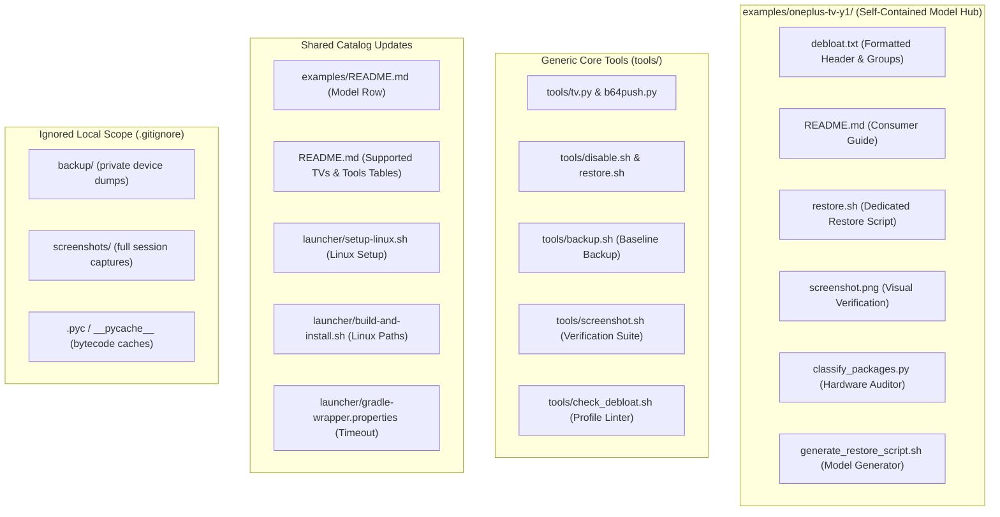

# Data Model: Segregation of TV Contributions

**Feature Branch**: `002-segregate-oneplus-contributions`  
**Date**: 2026-10-20

---

## 1. Entities & Relocation Schema

### Entity 1: Model Contribution Package (`ModelContribution`)
Represents the standalone upstream-ready package for a specific TV model, acting as a complete hub for consumers owning this hardware.

| Property | Location | Description | Upstream PR Inclusion |
|---|---|---|---|
| `debloat_profile` | `examples/oneplus-tv-y1/debloat.txt` | Formatted package disablement list with standard header and inline comments | **Yes** |
| `consumer_guide` | `examples/oneplus-tv-y1/README.md` | Comprehensive consumer documentation detailing device setup, debloat steps, launcher configuration, and restore commands | **Yes** |
| `model_restore` | `examples/oneplus-tv-y1/restore.sh` | Dedicated model restoration script (relocated from root `tools/` for brand neutrality) | **Yes** |
| `screenshot` | `examples/oneplus-tv-y1/screenshot.png` | Clean home screen visual verification image | **Yes** |
| `catalog_entry` | `examples/README.md` | Table entry describing the model, OS, and debloat notes | **Yes** |
| `supported_entry` | `README.md` | Row in the supported TV models table | **Yes** |

---

### Entity 2: Shared Tooling Enhancement (`CoreEnhancement`)
Represents brand-neutral system improvements that apply to all supported TVs.

| Property | Target File | Nature of Change | Upstream PR Inclusion |
|---|---|---|---|
| `linux_sdk_detection` | `launcher/build-and-install.sh` | Fallback detection for Linux `/usr/lib/jvm/java-17-openjdk-amd64` and `/opt/android-sdk` without breaking macOS | **Yes** |
| `wrapper_network_resilience` | `launcher/gradle/wrapper/gradle-wrapper.properties` | Increased network timeout (`60000`) and retries (`5`) to prevent flaky download failures | **Yes** |

---

### Entity 3: Generic Core Tools & Model Utilities (`GenericToolsAndModelUtilities`)
Scripts refactored into generic tools in `tools/` and model utilities in `examples/oneplus-tv-y1/`.

| Property | Relocated Clean Location | Scope | Description |
|---|---|---|---|
| `baseline_backup` | `tools/backup.sh` | Universal | Automated device snapshot backup tool |
| `visual_verifier` | `tools/screenshot.sh` | Universal | Automated screenshot capture & verification suite |
| `preferences_prompter` | `tools/check_debloat.sh` | Universal | Debloat profile validator and linter |
| `environment_installer` | `launcher/setup-linux.sh` | Universal (Linux) | Ubuntu/Debian system setup script for JDK 17 & SDK 34 |
| `package_classifier` | `examples/oneplus-tv-y1/classify_packages.py` | Model-specific | OnePlus Y1 hardware package classification utility |
| `restore_generator` | `examples/oneplus-tv-y1/generate_restore_script.sh` | Model-specific | Dynamic restore generator for OnePlus Y1 |

---

### Entity 4: Local Private Asset (`PrivateAsset`)
Data that must never be committed to git or exposed upstream.

| Property | Location | Handling Rule |
|---|---|---|
| `device_dumps` | `backup/*.txt` | Kept local; ignored by `.gitignore` |
| `bytecode_cache` | `**/*.pyc`, `**/__pycache__/` | Purged from git index via `git rm --cached`; ignored by `.gitignore` |
| `full_screenshot_session` | `screenshots/*.png` | Kept local for visual regression tracking |

---

## 2. File Organization Transition Diagram

